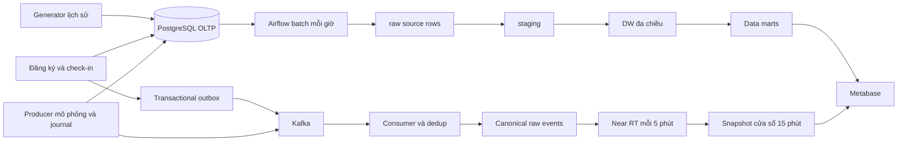

# Smart Hospital Data Warehouse

Đồ án kho dữ liệu hỗ trợ phân tích hoạt động khám chữa bệnh trên dữ liệu mô phỏng. Hệ thống có xử lý batch, xử lý gần thời gian thực, dashboard ngoại trú/nội trú/xét nghiệm và form đăng ký, tiếp nhận bệnh nhân.

**Công nghệ:** PostgreSQL 16 · Python 3.12 · Airflow 3.1 · Kafka 3.9 · Metabase · Docker Compose.

## Khởi động

Cài Docker Desktop với Linux containers, Docker Compose v2; trên Windows bật WSL 2. Máy cần đủ RAM và dung lượng cho nhiều dịch vụ cùng bộ nguồn khoảng 7,93 triệu dòng và các bản sao phân tích. Môi trường nghiệm thu trước đây cấp khoảng 15 GiB RAM cho Docker.

Clone repository, mở terminal tại thư mục gốc và tạo cấu hình local:

```powershell
Copy-Item .env.example .env
```

Linux/macOS dùng `cp .env.example .env`. Mẫu chứa mật khẩu minh họa cho local demo; có thể thay trước lần tạo database đầu tiên. Không commit `.env`. Với volume cũ, giữ thông tin đăng nhập khớp database: sửa biến môi trường không tự đổi mật khẩu PostgreSQL.

Chạy toàn bộ hệ thống bằng một lệnh:

```bash
docker compose up --build
```

Chạy nền bằng `docker compose up --build -d`. Không cần script PowerShell, file Compose con hoặc profiles. Các tác vụ khởi tạo tự động:

| Container | Công việc |
|---|---|
| `app-init` | Tạo roles/schema, áp dụng migration; sinh/nạp nguồn trống; chạy ETL đầu tiên nếu DW chưa sẵn sàng; refresh RT |
| `kafka-init` | Tạo ba topic nếu chưa có |
| `airflow-init` | Khởi tạo/nâng cấp metadata và tài khoản Airflow |
| `dashboard-init` | Cấu hình datasource DW và bốn dashboard Metabase |

Init container **Exited (0)** là bình thường. Database có dữ liệu được giữ lại, không tự reset hoặc ghi đè seed. Lần đầu trên nguồn trống có thể mất nhiều phút hoặc lâu hơn tùy cấu hình máy do sinh CSV, COPY và ETL hàng triệu dòng. Theo dõi:

```bash
docker compose ps -a
docker compose logs -f app-init dashboard-init
```

## Giao diện và đăng nhập

| Thành phần | Địa chỉ mặc định | Tài khoản |
|---|---|---|
| Đăng ký khám và quầy tiếp nhận demo | [localhost:28081](http://localhost:28081) | Không yêu cầu đăng nhập |
| Airflow | [localhost:28080](http://localhost:28080) | `admin` / `AIRFLOW_UI_PASSWORD` |
| Metabase | [localhost:23000](http://localhost:23000) | `METABASE_UI_EMAIL` / `METABASE_UI_PASSWORD` |
| PostgreSQL OLTP | `localhost:56432` | Database `hospital_oltp` |
| PostgreSQL DW | `localhost:56433` | Database `hospital_dwh` |
| Kafka | `localhost:29092` | Trong container dùng `kafka:9092` |

Giá trị mật khẩu và cổng ở `.env`. Metadata PostgreSQL không xuất cổng host; các giao diện được bind loopback cho local demo. Với volume cũ, thông tin đăng nhập ứng dụng cũng giữ theo tài khoản đã được tạo trước đó.

## Kiến trúc



Kho dùng **ROLAP trên PostgreSQL**, mô hình **fact constellation / galaxy schema**, gồm **5 fact vật lý, 7 dimension, 2 bridge**. Không triển khai cube MOLAP. Các lớp gồm `raw`, `stg`, `dw`, `mart`; `ops` giữ audit, watermark, DQ và quarantine.

| Fact | Một dòng biểu diễn |
|---|---|
| `fact_appointment` | Một lịch hẹn |
| `fact_encounter` | Một lượt ngoại trú hoặc đợt nội trú |
| `fact_lab_order` | Một chỉ định xét nghiệm |
| `fact_bed_assignment` | Một khoảng cấp giường |
| `fact_bed_snapshot_daily` | Một giường × ngày tại 00:00 Việt Nam |

Bảy chiều là ngày, bệnh nhân, khoa, bác sĩ, giường, loại xét nghiệm và chẩn đoán. Hai bridge nối encounter với bác sĩ và chẩn đoán. Bác sĩ dùng SCD Type 2 cho lịch sử quan sát được; seed thiếu lịch sử phiên bản quá khứ nên liên kết không có coverage dùng unknown key.

## Dữ liệu và dashboard

Cấu hình mặc định: **6.000 encounter/ngày × 180 ngày = 1.080.000 encounter**, gồm 1.038.462 ngoại trú và 41.538 nội trú, trong khoảng **06/05–01/11/2026**. Tổng 13 bảng nguồn lịch sử là **7.931.367 dòng**, không phải số lượt khám. Hai bảng hỗ trợ đăng ký/outbox được quản lý riêng.

Startup lưu CSV và manifest mới trong `artifacts/runtime/`, được Git bỏ qua. Hồ sơ lịch sử chi tiết được giữ local, không nằm trong repository; bản tóm tắt ở `docs/VALIDATION.md`. Có thể dùng bộ nhỏ bằng cách sửa `.env` **trước khi khởi tạo nguồn trống**:

```dotenv
BOOTSTRAP_ENCOUNTERS_PER_DAY=100
BOOTSTRAP_HORIZON_DAYS=7
```

Các biến này không thay dataset trong database có dữ liệu. Bộ nhỏ có số liệu khác bộ nghiệm thu.

| Dashboard | Nội dung |
|---|---|
| Executive Overview | Tổng quan khám, nhập viện, giường và xét nghiệm |
| Outpatient Operations | Lượt khám, chờ khám, no-show |
| Inpatient & Bed Management | Nhập viện, LOS, snapshot giường |
| Laboratory & Real-Time | Sản lượng xét nghiệm, TAT, đúng hạn, RT01/RT02 |

Có **11 KPI**: OP01–03, IP01–03, LAB01–03 và RT01–02. Trung bình/tỷ lệ tính theo tổng thành phần; mỗi KPI dùng đúng ngày nghiệp vụ. Occupancy chụp lúc 00:00 Việt Nam. RT đếm distinct check-in và lab hoàn thành trong `(as_of − 15 phút, as_of]`.

Hai DAG `hospital_batch` và `hospital_near_rt` có lịch mỗi giờ/mỗi 5 phút. Hiện DAG được tạo paused để người dùng chủ động bật lịch sau khởi tạo; volume cũ giữ trạng thái đã lưu. Refresh dashboard không tự kích hoạt ETL. Khi demo nghiệp vụ mới, chọn đúng ngày và kiểm tra `as_of`; RT bằng 0 có thể hợp lệ khi không có event trong cửa sổ.

Health check scheduler local cho phép heartbeat trễ tối đa 300 giây để chịu độ lệch thời gian đã quan sát trên Windows/WSL; đây không phải SLA xử lý. Nếu RT hoặc lịch chạy bất thường, kiểm tra đồng hồ Docker/WSL và thời điểm heartbeat thay vì chỉ xem container đang chạy.

## Đăng ký và tiếp nhận

Form: họ tên → mục đích → chuyên khoa → bác sĩ → ngày giờ → xem lại → xác nhận. Chỉ sử dụng thông tin mô phỏng.

- Tái khám cần mã bệnh nhân; lần đầu tạo hồ sơ tạm và lịch SCHEDULED, cấp mã BN chính thức khi check-in.
- Đặt trước ít nhất 30 phút, tối đa 365 ngày. Check-in từ 30 phút trước đến 30 phút sau giờ hẹn.
- Check-in chuyển lịch ATTENDED, tạo encounter CHECKED_IN và ghi sự kiện cùng transaction qua PostgreSQL outbox.
- Quá giờ hẹn hơn 30 phút chưa check-in, lịch thuộc luồng đăng ký tự chuyển NO_SHOW; batch cập nhật DW và OP03. Không tự phân loại lại toàn bộ seed.
- Đặt lịch chưa tăng OP01/RT01/RT02. Check-in có thể tăng RT01 sau consumer/near-RT; OP01 cần bắt đầu khám; RT02 cần xét nghiệm hoàn thành.

Chi tiết: [luồng tiếp nhận](docs/BOOKING_RECEPTION.md).

## Các lệnh thường dùng

```bash
# Trạng thái và log
docker compose ps -a
docker compose logs -f booking consumer

# Batch và RT thủ công
docker compose run --rm app-init python -m batch_pipeline.jobs.batch --mode incremental
docker compose run --rm app-init python -m batch_pipeline.jobs.near_rt

# Tạo hành trình OP/lab mô phỏng
docker compose run --rm app-init python -m streaming.producer --count 1 --full-journey

# Cập nhật dashboard
docker compose run --rm dashboard-init

# Unit tests và fixture database riêng cho tiếp nhận
docker compose run --rm app-init python -m unittest discover -s tests -p 'test_*.py'

# Dừng hoặc gỡ container, giữ dữ liệu named volumes
docker compose stop
docker compose down
```

`docker compose down -v` xóa cả named volumes và dữ liệu. Không dùng khi cần giữ dữ liệu demo.

## Cấu trúc repository

```text
.
├── compose.yaml              # Điểm chạy từ thư mục gốc
├── Dockerfile                # Image ứng dụng Python
├── airflow.Dockerfile        # Image Airflow
├── .env.example              # Cấu hình local mẫu
├── requirements.lock.txt
├── infrastructure/           # Init metadata, hồ sơ version/image
├── src/
│   ├── operations/           # Bootstrap, kết nối DB, migration, bảo trì
│   ├── data_sources/         # Generator, loader
│   ├── data_quality/         # Kiểm tra dữ liệu nguồn
│   ├── batch_pipeline/       # Jobs và DAG Airflow
│   ├── streaming/            # Producer, consumer, hợp đồng sự kiện
│   ├── booking/              # Form, API, tiếp nhận, outbox
│   └── analytics/            # Dashboard và Metabase API
├── sql/                      # DDL, migration, transformation, queries
├── tests/                    # Unit và integration tests
└── docs/                     # Báo cáo đã sửa, hướng dẫn, sơ đồ, ảnh demo
```

Thư mục `scripts/` cũ đã được bỏ. Module Python còn được ứng dụng và kiểm thử sử dụng chuyển vào `src/operations/`, chạy bằng `python -m operations.<module>` trong container. Compose mount repository hiện tại tại `/app`, không dùng code snapshot trong `artifacts/generated/phase5_runtime`.

## Tài liệu và phạm vi

- [Hướng dẫn tổng thể dự án](docs/PROJECT_GUIDE.md).
- Hồ sơ triển khai: [Phase 0](docs/PHASE_0_FINAL.md), [Phase 1](docs/PHASE_1_FINAL.md), [Phase 2](docs/PHASE_2_FINAL.md), [Phase 3](docs/PHASE_3_FINAL.md), [Phase 4](docs/PHASE_4_FINAL.md), [Phase 5](docs/PHASE_5_FINAL.md).
- [Kết quả kiểm chứng và giới hạn](docs/VALIDATION.md).
- [ERD nguồn](docs/diagrams/oltp_erd.mmd), [mô hình DW](docs/diagrams/dw_star_schema.mmd).
- [Bản báo cáo đã chỉnh sửa](docs/Tieu_luan_Smart_Hospital_DW_Da_sua_ra_soat_06-11-2026.docx).

Repository giữ mã chạy, báo cáo đã chỉnh sửa, sơ đồ, ảnh form, tài liệu tổng thể, sáu báo cáo Phase 0–5 và kết quả kiểm chứng tổng hợp. Tài liệu mẫu, bản nháp, nhật ký thao tác và raw evidence giữ local. Các báo cáo phase mô tả phiên bản tại thời điểm nghiệm thu, có thể tham chiếu lệnh cũ hoặc raw evidence không nằm trên GitHub; dùng README này cho cách chạy hiện tại. Benchmark chỉ áp dụng cho workload/máy được đo, không phải cam kết production.

Đây là demo học thuật một máy, một Kafka broker; chưa có CDC tổng quát hay HA. Batch còn kiểm tra toàn nguồn và restate facts. Không đưa `.env`, CSV sinh, SQLite journals, database dump, backup hoặc runtime snapshot lên GitHub. `.gitignore` đã loại dữ liệu local này; kiểm tra `git status` trước khi commit.
