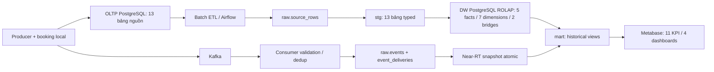

# Phase 5 — Báo cáo triển khai và nghiệm thu

## Cách đọc báo cáo này

Phase 5 nối tiếp [Phase 4](PHASE_4_FINAL.md), hoàn thiện mô hình phân tích và kiểm chứng trên bộ dữ liệu lớn hơn. Mục 1–8 ghi nhận nghiệm thu ngày 03/11/2026; mục 9–12 bổ sung bản đồ thay đổi thiết kế và các cập nhật thực hiện ngày 05–06/11. Vì vậy, nhận định “chưa có outbox”, form cũ, scripts hoặc snapshot trong mục 1–8 chỉ mô tả mốc nghiệm thu đó, không phải toàn bộ trạng thái hiện hành.

Người mới nên đọc phần nghiệp vụ và grain trước, sau đó xem mục 9 về chuyển thiết kế, mục 10 về form mới, mục 11 về khởi động và mục 12 về đường đi dữ liệu. Cách chạy hiện hành ở [README](../README.md); sơ đồ tích hợp và lộ trình đọc ở [PROJECT_GUIDE](PROJECT_GUIDE.md). Các file raw evidence được dẫn trong nội dung lịch sử giữ local, bản tổng hợp công khai ở [VALIDATION](VALIDATION.md).

Ngày lập báo cáo: **03/11/2026**, giờ Việt Nam. Đây là kết quả triển khai Phase 5, với yêu cầu của người dùng thay thế chỉ tiêu tròn 5 triệu dòng: **trung bình 6.000 lượt khám/ngày trong 180 ngày**. “Lượt khám” được hiểu là tổng OP + IP; không cộng lab order, quan hệ, bản sao raw/stg/DW hoặc Kafka vào số lượt khám.

**Trạng thái: hoàn tất Phase 5 trong phạm vi nghiệm thu dưới đây.** Mô hình, dữ liệu, đối soát, benchmark, form/dashboard, hai DAG thực tế và restore toàn bộ database Phase 5 đều đã có bằng chứng đạt. Các giới hạn về production, browser rendering và historical doctor coverage được công bố riêng.

## 1. Kiến trúc và mô hình đã triển khai

Hệ thống dùng **ROLAP trên PostgreSQL**: fact, dimension và bridge được lưu trong các bảng quan hệ; SQL thực hiện lọc, tổng hợp và nối theo chiều phân tích. Metabase đọc lớp mart/safe views. Không có cube MOLAP hoặc dịch vụ OLAP chuyên dụng được đưa vào đợt này.

Mô hình là **fact constellation (galaxy schema)** gồm nhiều fact dùng chung các dimension; mỗi nhóm nghiệp vụ tạo một star trong constellation. Đích vật lý có **5 fact tables, 7 dimension tables, 2 bridge tables**. Hai bridge biểu diễn quan hệ đa trị, không được đếm là fact nghiệp vụ mới.

| Fact | Grain | Vai trò |
|---|---|---|
| `dw.fact_appointment` | Một appointment_id | Lịch hẹn và no-show |
| `dw.fact_encounter` | Một encounter_id | OP visits/waiting và IP admission/LOS |
| `dw.fact_lab_order` | Một lab_order_id | Sản lượng, TAT và đúng hạn |
| `dw.fact_bed_assignment` | Một bed_assignment_id | Khoảng sử dụng giường, chuyển giường |
| `dw.fact_bed_snapshot_daily` | Một bed × ngày local lúc 00:00 | Occupancy lịch sử |

Bảy dimension là `dim_date`, `dim_patient`, `dim_department`, `dim_doctor`, `dim_bed`, `dim_lab_test_type`, `dim_diagnosis`. Doctor giữ SCD Type 2 với khoảng hiệu lực [effective_from, effective_to); diagnosis dùng mã synthetic ổn định và cập nhật mô tả theo SCD1. Danh mục chẩn đoán synthetic chưa được tuyên bố là danh mục ICD đã kiểm chứng.

Hai bridge là `bridge_encounter_doctor` và `bridge_encounter_diagnosis`, giữ stable source association_id và business IDs. Các truy vấn lọc đồng thời hai quan hệ dùng EXISTS/semi-join để không nhân số lượt khám. Fixture một encounter có 2 bác sĩ, 3 chẩn đoán vẫn tính 1 encounter; update/void và rerun đã được kiểm tra.

Hai fact OP/IP trước đây được gộp thành `fact_encounter`; tên cũ còn ở compatibility views và không được tính là bảng fact vật lý. Lớp fact operational event đã được loại; near-RT đọc canonical `raw.events`, còn `raw.event_deliveries` giữ audit từng delivery.

Luồng dữ liệu:



DDL và sơ đồ: [007_phase5_warehouse.sql](../sql/migrations/007_phase5_warehouse.sql), [009_phase5_canonical_rt.sql](../sql/migrations/009_phase5_canonical_rt.sql), [DW diagram](diagrams/dw_star_schema.mmd), [OLTP diagram](diagrams/oltp_erd.mmd). Inventory thực sau DAG ở [warehouse_after_dags.json](../artifacts/phase5/warehouse_after_dags.json).

## 2. Cách tính và dữ liệu thực tế

**6.000 × 180 = 1.080.000 encounters gốc**, gồm **1.038.462 OP + 41.538 IP**. Horizon nghiệp vụ là **06/05/2026–01/11/2026**, đủ 180 ngày Việt Nam; seed as_of được khóa tại **02/11/2026 00:00 +07:00**. Phân bố ngày/khoa có biến động; không ép mọi ngày bằng 6.000.

Tổng số dòng nguồn được suy ra từ các thực thể và tỷ lệ nghiệp vụ:

| Bảng nguồn | Dòng gốc |
|---|---:|
| patients | 207.692 |
| departments | 10 |
| doctors | 600 |
| appointments | 726.923 |
| encounters | 1.080.000 |
| beds | 1.231 |
| bed_status_history | 1.537 |
| bed_assignments | 57.986 |
| lab_test_types | 20 |
| lab_orders | 3.024.000 |
| **10 bảng nguồn cốt lõi** | **5.099.999** |
| diagnoses | 100 |
| encounter_doctors | 1.307.134 |
| encounter_diagnoses | 1.524.134 |
| **Tổng 13 bảng nguồn** | **7.931.367** |

Hai bảng association có tổng 2.831.268 dòng. Tổng 5.099.999 core rows là kết quả của quy mô 1.080.000 encounters và các rule liên quan; không phải chỉ tiêu làm tròn hoặc 5 triệu lượt khám.

Generator dùng chunk CSV 25.000 dòng, random stream ổn định và cấu trúc SQLite tạm trên đĩa. Manifest có count/config/chunk hashes. Thời gian sinh là **348,658 giây**, peak RSS của tiến trình **34.967.552 bytes (33,35 MiB)**; tổng CSV **1.327.636.056 bytes**. Hash nghiệp vụ toàn bộ seed: `9919c1b6593192bdadc61576beca72e6b469acd2738014c8fcf970b0f8c96c4e`.

Full load nhập đủ 7.931.367 dòng; **106 constraints đã validate, 58 full SQL DQ checks, 0 lỗi**. Lần resume không thêm dòng: 0 loaded / 7.931.367 resumed, DQ vẫn đạt. Đây là kiểm tra toàn bộ bằng SQL, không phải lấy mẫu.

Các bài thử live sau seed tạo thêm **12 dòng nguồn**: appointments +3, encounters +4, bed_assignments +1, lab_orders +4. Vì vậy nguồn sau live là **7.931.379 dòng**, encounters là **1.080.004**. Phần delta được ghi riêng và không làm thay đổi cách tính quy mô gốc. Main source không bị sửa bởi các bài thử SCD2 ở database riêng.

Bằng chứng: [dataset_manifest.json](../artifacts/phase5/dataset_manifest.json), [source_load.json](../artifacts/phase5/source_load.json), [source_resume.json](../artifacts/phase5/source_resume.json), [live_corpus_manifest.json](../artifacts/phase5/live_corpus_manifest.json).

## 3. ETL, đối soát, SCD2 và 11 KPI

Initial ETL trích đủ 13 bảng với **7.931.367 dòng**, thời gian monotonic **870,812 giây**. Các ordered digests kiểm tra key/payload giữa source và staging trên toàn bộ 13 bảng; fact và bridge được đối soát đúng grain. Incremental sau live thành công trong **398,847 giây**, trích 210.875 dòng theo lookback/restatement.

Inventory hiện tại sau DAG ngày 03/11:

| Bảng DW | Dòng |
|---|---:|
| fact_appointment | 726.926 |
| fact_encounter | 1.080.004 |
| fact_lab_order | 3.024.004 |
| fact_bed_assignment | 57.987 |
| fact_bed_snapshot_daily | 224.042 |
| bridge_encounter_doctor | 1.307.134 |
| bridge_encounter_diagnosis | 1.524.134 |

Snapshot giường lúc benchmark/initial ETL là **222.811 dòng**. DAG ngày 03/11 bổ sung hợp lệ một ngày snapshot cho 1.231 giường, thành **224.042 dòng**; không có snapshot tương lai hay snapshot invalid. Hai mốc này có phạm vi thời gian khác nhau, không phải sai lệch paired benchmark.

Giữ đủ 11 KPI: OP01 visits, OP02 waiting, OP03 no-show; IP01 admissions, IP02 occupancy 00:00 Việt Nam, IP03 LOS theo ngày xuất viện; LAB01 completed, LAB02 TAT, LAB03 đúng hạn theo target đóng băng; RT01 distinct check-in và RT02 distinct completed lab trong cửa sổ 15 phút. Weighted averages dùng tổng measure / tổng mẫu hợp lệ. Mẫu số 0 trả NULL/N/A; OP và IP dùng đúng vai trò ngày riêng.

**Giới hạn SCD2 lịch sử:** nguồn seed không cung cấp doctor version history cho 180 ngày. Toàn bộ **1.080.000 historical encounters và 1.307.134 historical doctor bridge rows có doctor_sk = 0 (100%)**, đồng thời giữ doctor_id để audit. Không backdate profile hiện tại để bịa coverage. Bốn encounters live mới có doctor_sk đã biết. Không dùng query lịch sử toàn UNKNOWN làm bằng chứng đã phân tích được profile bác sĩ 6 tháng.

Minh chứng SCD2 live riêng dùng OLTP và DWH fixture databases: doctor_id ổn định, active → inactive → active, doctor_sk đổi, interval không overlap, một current row, fact/bridge liên kết đúng mốc, rerun không thêm version thừa. Các fixture staging riêng cũng kiểm tra hai bác sĩ/ba chẩn đoán, unknown key và propagation khi void.

Kết quả kiểm tra: **42 unit tests, 34 design checks, 28 historical SQL fixture assertions, 9 historical KPI đối soát nguồn ↔ mart**; không có test thất bại. Hai KPI RT được kiểm chứng riêng bằng canonical events ↔ snapshot và cases duplicate/late/boundary.

Bằng chứng: [initial_etl_success.json](../artifacts/phase5/initial_etl_success.json), [live_tail_etl.json](../artifacts/phase5/live_tail_etl.json), [warehouse_after_dags.json](../artifacts/phase5/warehouse_after_dags.json), [unit_tests.json](../artifacts/phase5/unit_tests.json), [sql_fixtures.json](../artifacts/phase5/sql_fixtures.json), [historical_regression.json](../artifacts/phase5/historical_regression.json), [live_scd2_evidence.json](../artifacts/phase5/live_scd2_evidence.json), [scd2_bridge_evidence.json](../artifacts/phase5/scd2_bridge_evidence.json).

## 4. Kafka, form local, dashboards và Airflow

Live corpus có **28 canonical events, 32 deliveries, 2 quarantines**, đủ 13 loại event; consumer đã bắt kịp toàn bộ 9 partitions tại lần kiểm tra. Thử consumer restart và replay **30 positions** không nhân canonical events. Các case source-commit crash, broker publish failure/resend, cùng UUID lặp, UUID conflict, malformed bytes, khác UUID cùng entity, late trong window và reverse order đã đạt.

RT dùng cửa sổ **(as_of − 15 phút, as_of]**, yêu cầu ingested_at ≤ as_of, distinct business entity và snapshot atomic đủ các khoa. Snapshot nonempty dùng cho paired SQL được ghi nhận thật tại **02/11/2026 22:40:59,960937 +07:00**: **3 check-ins + 3 completed labs, 11 department rows, 10 khoa idle**. Không sửa event_time/ingested_at để giữ dữ liệu trong cửa sổ.

Snapshot vận hành sau DAG ngày 03/11 có **0 check-ins / 0 completed labs**, đúng vì các sự kiện cũ đã hết hạn. Đây là snapshot hiện tại, tách biệt với as_of cố định dùng để so sánh hai phía SQL. Không suy ra throughput hoặc scheduled end-to-end latency từ phép so sánh SQL này.

Booking API/form local đã kiểm tra idempotency, 4 retries đồng thời chỉ tạo một appointment, content conflict, kiểm tra patient/doctor/department/datetime, CSRF/host/content-type, journal crash và broker recovery. Booking mới không tự tạo encounter. `warehouse_received` dựa trên fact_appointment; booking.created hiển thị RT **“không áp dụng”**, không giả đã đóng góp RT01/RT02. Date dimension bao phủ cả lịch hẹn tương lai đến 02/12/2026.

Bốn dashboards Metabase đã provision và kiểm tra qua API:

| Dashboard | URL |
|---|---|
| Executive Overview | http://localhost:23000/dashboard/2 |
| Outpatient Operations | http://localhost:23000/dashboard/3 |
| Inpatient & Bed Management | http://localhost:23000/dashboard/4 |
| Laboratory & Real-Time | http://localhost:23000/dashboard/5 |

Đã thực thi **31 native queries** cùng bộ lọc khoa; **16 API assertions** đối chiếu KPI/scalar/date/layout đạt. Phạm vi kiểm chứng giao diện là API layout và kết quả SQL; **chưa nghiệm thu rendering trong browser**.

Hai DAG Airflow đã chạy thật ở project cô lập, loại run manual: `hospital_batch` **386,552 giây**, `hospital_near_rt` **3,235 giây**, tất cả tasks thành công, source counts không đổi. Cron creation tạm tắt trong acceptance để tránh run ngoài kế hoạch; cấu hình scheduler chuẩn đã được khôi phục. Trạng thái paused ban đầu của cả hai DAG là true và đã được trả về true. Kết quả này chứng minh đường DAG thực tế, chưa phải phép đo tải dài hạn của lịch cron hourly/5 phút.

Bằng chứng: [streaming_failure_tests.json](../artifacts/phase5/streaming_failure_tests.json), [consumer_offsets.json](../artifacts/phase5/consumer_offsets.json), [booking_demo.json](../artifacts/phase5/booking_demo.json), [dashboards.json](../artifacts/phase5/dashboards.json), [dashboard_reconciliation.json](../artifacts/phase5/dashboard_reconciliation.json), [airflow_acceptance.json](../artifacts/phase5/airflow_acceptance.json), [hospital_batch_airflow.json](../artifacts/phase5/hospital_batch_airflow.json), [hospital_near_rt_airflow.json](../artifacts/phase5/hospital_near_rt_airflow.json).

## 5. Benchmark trước/sau và tối ưu đã đo

Baseline chính là mô hình **5/7/2 đúng nghiệp vụ**, trên cùng bộ nguồn gốc + 12 live rows và cùng corpus RT đã khóa. Không so tốc độ dataset demo cũ với dataset mới.

Máy đo dùng AMD Ryzen 7 7840HS (8 cores / 16 logical processors), Windows 11 Pro và khoảng 32 GB RAM host; Docker nhận 16 CPUs và 15,22 GiB RAM. PostgreSQL là 16.15. Cấu hình và giới hạn đo thực tế được lưu trong [environment.json](../artifacts/phase5/environment.json) và phần environment của mỗi benchmark JSON.

Protocol chính: **32 biến thể**, một client, warm cache, 3 warmups + 20 samples/biến thể, first run ghi riêng, timeout 120 giây. Mỗi phía có **768 executions thành công**, gồm first/warmup/samples; 32 EXPLAIN ANALYZE plans lưu riêng. Thứ tự truy vấn được xoay xác định. Thời gian SQL lấy từ monotonic clock quanh SELECT và fetchall; plan execution không được trộn vào timing samples. Hai phía đều `VACUUM (ANALYZE, PARALLEL 0)` ở source/DWH; giữ cùng query text, parameters, as_of, settings, business counts và canonical event digest.

**32/32 result digests bằng nhau** giữa trước và sau; không timeout/error. Mỗi query có median, p95, min/max và raw runs trong JSON/CSV. Main query hash `8994e8ff175a08d117d254de7e219d9e743ef696a6027e072214e95e0e5bcf68`; locked corpus hash `9b82f681a8f890c71e1d30b61f2107a627216a87a9d6be21759c4e7a50dfde3d`.

Tối ưu được chọn từ plan bottlenecks là ba B-tree indexes:

- `phase5_doctor_participation_lookup`: doctor_id, encounter_id, INCLUDE role, partial WHERE is_active.
- `phase5_diagnosis_lookup`: diagnosis_id, encounter_id, INCLUDE is_primary, partial WHERE is_active.
- `phase5_patient_history_lookup`: patient_sk, coalesce(checked_in_at, admitted_at) DESC, encounter_id DESC.

Tổng dung lượng ba index là **159.686.656 bytes (152,289 MiB)**; lần apply đầu mất **5,893 giây**. Plan cho Q10/Q11/Q12 chuyển bridge Seq Scan sang Index Only Scan; Q15 chuyển full encounter scan sang patient lookup. Query semantics và allocation rules không thay đổi.

### Kết quả chính — 32 biến thể

Tất cả đơn vị timing bên dưới là **ms**. Đây là paired observations trên một host, chưa phải bảo đảm hiệu năng production.

| Query | Median trước | Median sau | p95 trước | p95 sau | Median trước/sau |
|---|---:|---:|---:|---:|---:|
| Q01_visits_7d | 32.481 | 15.118 | 58.863 | 18.789 | 2.148 |
| Q01_visits_30d | 63.400 | 30.825 | 112.206 | 35.197 | 2.057 |
| Q01_visits_180d | 297.310 | 133.310 | 496.757 | 140.617 | 2.230 |
| Q01_visits_busy | 206.672 | 91.130 | 255.369 | 106.021 | 2.268 |
| Q01_visits_quiet | 197.234 | 88.296 | 288.018 | 106.230 | 2.234 |
| Q02_waiting_7d | 27.260 | 13.440 | 60.195 | 17.296 | 2.028 |
| Q02_waiting_30d | 61.529 | 28.460 | 103.725 | 31.939 | 2.162 |
| Q02_waiting_180d | 268.444 | 118.212 | 385.120 | 127.103 | 2.271 |
| Q03_noshow_7d | 89.369 | 42.199 | 128.430 | 56.948 | 2.118 |
| Q03_noshow_30d | 98.876 | 43.911 | 131.002 | 46.073 | 2.252 |
| Q03_noshow_180d | 152.532 | 65.971 | 223.375 | 73.602 | 2.312 |
| Q04_admissions_7d | 5.694 | 3.210 | 14.744 | 4.023 | 1.774 |
| Q04_admissions_30d | 16.773 | 6.839 | 29.558 | 9.992 | 2.453 |
| Q04_admissions_180d | 104.021 | 53.626 | 205.355 | 64.690 | 1.940 |
| Q05_los_7d | 5.543 | 3.013 | 8.829 | 3.340 | 1.840 |
| Q05_los_30d | 15.586 | 7.613 | 36.353 | 10.822 | 2.047 |
| Q05_los_180d | 115.230 | 56.957 | 156.144 | 78.514 | 2.023 |
| Q06_occupancy_180d | 28.307 | 13.396 | 56.355 | 15.039 | 2.113 |
| Q07_labs_7d | 158.766 | 57.450 | 280.944 | 64.692 | 2.764 |
| Q07_labs_30d | 456.888 | 200.102 | 772.824 | 250.690 | 2.283 |
| Q07_labs_180d | 843.977 | 383.846 | 1290.980 | 426.618 | 2.199 |
| Q08_lab_trend_7d | 35.536 | 16.696 | 88.827 | 21.519 | 2.128 |
| Q08_lab_trend_30d | 152.169 | 72.801 | 274.644 | 91.733 | 2.090 |
| Q08_lab_trend_180d | 465.016 | 210.714 | 706.954 | 227.296 | 2.207 |
| Q09_doctor_history_180d | 482.442 | 218.021 | 820.047 | 237.876 | 2.213 |
| Q10_participation_180d | 135.720 | 13.043 | 175.071 | 16.030 | 10.405 |
| Q11_diagnoses_180d | 155.950 | 45.111 | 253.967 | 48.933 | 3.457 |
| Q12_two_bridges_180d | 347.487 | 22.779 | 472.821 | 27.318 | 15.255 |
| Q13_bed_intervals_180d | 30.735 | 16.147 | 42.225 | 18.021 | 1.903 |
| Q14_rt_compute_180d | 4.046 | 2.213 | 6.745 | 2.618 | 1.828 |
| Q14_rt_read_180d | 2.038 | 1.277 | 2.836 | 1.600 | 1.596 |
| Q15_patient_history_180d | 136.362 | 1.928 | 243.285 | 2.169 | 70.716 |

### Control đảo thứ tự để giới hạn kết luận

Ngoài main pair, đã chạy control **6 queries** với gỡ/khôi phục đúng ba index và cùng corpus/settings; hai phía control đều đạt **6/6 result digests bằng nhau**. Control hỗ trợ kết luận causal cho các lookup liên quan:

| Query | Median không index (ms) | Median có index (ms) | Tỷ số |
|---|---:|---:|---:|
| Q10 participation | 57,411 | 7,085 | 8,10× |
| Q11 diagnoses | 75,772 | 22,603 | 3,35× |
| Q12 lọc hai bridges | 157,028 | 11,646 | 13,48× |
| Q15 patient history | 67,716 | 1,802 | 37,57× |
| Q07 labs, query đối chứng | 401,959 | 410,493 | 0,98× |
| Q14 RT read, query đối chứng | 1,272 | 1,068 | 1,19× |

Q07 trong control **chậm hơn khoảng 2,12%** theo median. Các query không liên quan cũng biến động do cache/tài nguyên; vì vậy không quy toàn bộ mức cải thiện main pair cho ba index và **không kết luận toàn hệ thống nhanh hơn 2×**. Kết luận có bằng chứng là bốn workload lookup được cải thiện khoảng **3,35–37,57×** theo median ở control, với exact result parity.

Subset contention chạy Q10/Q12/Q15 bằng các batch tối đa **5 clients**, 20 rounds, 100 timing samples/query/phía; toàn bộ result digests bằng nhau. Đây là phép thử contention giới hạn, không phải sustained throughput/QPS hay SLA. Kết quả đầy đủ nằm ở benchmark_contention, tách khỏi báo cáo một client.

Bằng chứng: [benchmark/comparison.json](../artifacts/phase5/benchmark/comparison.json), [before JSON](../artifacts/phase5/benchmark/benchmark_before.json), [after JSON](../artifacts/phase5/benchmark/benchmark_after.json), [control/comparison.json](../artifacts/phase5/benchmark_control/comparison.json), [contention/comparison.json](../artifacts/phase5/benchmark_contention/comparison.json), [lookup_plan_comparison.json](../artifacts/phase5/lookup_plan_comparison.json), [optimization_applied.json](../artifacts/phase5/optimization_applied.json), [migration 010](../sql/migrations/010_phase5_lookup_indexes.sql). Plans và CSV nằm trong cùng các thư mục benchmark.

## 6. Cô lập, prerequisites và phục hồi

Project thực thi là `smart_hospital_dw_phase5`, dùng volumes/network riêng và code snapshot ở `artifacts/generated/phase5_runtime/code`. Các ports chỉ bind loopback: OLTP 56432, DWH 56433, Kafka 29092, booking 28081, Airflow 28080, Metabase 23000. .env riêng được ignore; 14 secrets mạnh/duy nhất và 10 database role authentications đã được kiểm tra, không đưa giá trị credential vào evidence.

Demo gốc được giữ offline. Bảy volumes của demo cũ đã được backup read-only; ba PostgreSQL clusters đã restore kiểm tra, journals SQLite được kiểm tra integrity. Chưa cutover schema/code mới lên demo cũ.

Các sự cố prerequisite được giữ bằng chứng:

- Initial ETL rollback do role ETL không có quyền tạo index trên staging do admin sở hữu. Sửa bằng migration mới 008 do admin chạy; runtime ETL không tự DDL. Bài thử đúng role hospital_etl đã đạt.
- PostgreSQL parallel operation gặp /dev/shm 64 MiB không đủ. Source/DWH benchmark dùng 256 MiB trước cả hai phía; không thay work_mem hoặc tắt planner path giữa trước/sau.
- Clock runtime đã quan sát nhảy khoảng 116 giây và có lúc đảo chiều. Không chỉnh clock/timestamps. Nghiệp vụ dùng source observation clock; audit start/finish cùng DWH clock; durations báo từ monotonic clock. Không suy elapsed từ chênh timestamps khi clock biến động.
- Query doctor history cast hiệu lực ±infinity sang text để driver fetch/decode hợp lệ; SQL đã khóa trước baseline.

Phục hồi **toàn bộ dữ liệu Phase 5 sau DAG**: **Đạt**.

Đã backup và restore đủ bốn database từ custom archives giữ ownership/ACL. Đối soát toàn bộ dữ liệu của bản restore đạt:

| Database | Bảng | Dòng đã đối soát |
|---|---:|---:|
| OLTP | 16 | 7.931.709 |
| DWH | 39 | 24.438.332 |
| Airflow metadata | 63 | 488 |
| Metabase metadata | 172 | 2.492 |

Các số trên gồm bảng nghiệp vụ, raw/staging, audit và metadata tương ứng, không phải số lượt khám mới. Toàn bộ ordered row digests, sequences, database policies và 11 KPI khớp; lượt verify cuối mất **223,891 giây monotonic**, chưa cộng thời gian dump/restore. Bảy application roles đã authenticate và kiểm tra quyền thực trên bản restore; reader bị từ chối UPDATE, reporter bị từ chối đọc raw. Không thêm dòng nghiệp vụ trong bài kiểm tra quyền.

Catalog fingerprints ban đầu có khác biệt biểu diễn của CHECK/view và vị trí cột đã drop sau pg_restore. Kết quả fingerprint gốc vẫn được giữ trong evidence. Để kiểm tra đầy đủ schema mà không bỏ qua các nhóm đối tượng này, đã restore schema-only tham chiếu từ **chính bốn archives có SHA-256 đã khóa**, rồi đối chiếu schema của bản full restore với tham chiếu; ownership/ACL và số đối tượng gốc vẫn được kiểm tra trực tiếp. Các phép đối chiếu đều đạt.

Hai journals được giải nén kiểm tra SQLite integrity thành công. Sau recovery, trạng thái chạy của cả 7 ứng dụng được khôi phục, 4 database và các health checks đều đạt; Kafka/consumer có **lag 0 trên 9 partitions**. Database gốc không bị ghi đè, demo cũ không bị sửa và hash `.env` gốc không đổi.

Bằng chứng: [recovery_archives.json](../artifacts/phase5/recovery_archives.json), [recovery_verification.json](../artifacts/phase5/recovery_verification.json), [recovery_health.json](../artifacts/phase5/recovery_health.json), [recovery_baseline_summary.json](../artifacts/phase5/recovery_baseline_summary.json).

Phạm vi là restore sang **database tên mới trong cùng các PostgreSQL clusters**, dùng các roles hiện có và giữ ownership/ACL của archive. Role SQL được backup riêng; chưa áp dụng role archives lên cluster mới. Bài thử này kiểm tra khôi phục database và quyền ứng dụng, chưa chứng minh dựng lại toàn bộ hạ tầng sau khi mất máy. Kafka có offline archive; chưa chạy broker mới từ archive đó.

Helper [phase5_recovery.ps1](../scripts/phase5_recovery.ps1) và [phase5_recovery.py](../scripts/phase5_recovery.py) thực hiện quy trình dừng/lưu trạng thái ứng dụng đúng project, backup PostgreSQL OLTP/DWH/Airflow/Metabase cùng roles, journals/Kafka, restore sang database tên mới và so sánh schema/sequences/table hashes/11 KPI; sau đó khôi phục trạng thái trước recovery. Nội dung archive thực và credentials không nằm trong package giao code.

Packaging loại generated runtime/dataset, backup directories, credential variants, database dumps và compressed backup archives; giữ .env.example, migrations và evidence JSON/CSV/plans không chứa secrets.

Bằng chứng môi trường cũ: [backups.json](../artifacts/phase5/backups.json), [restore_verification.json](../artifacts/phase5/restore_verification.json), [secret_rotation.json](../artifacts/phase5/secret_rotation.json), [clock_anomaly.json](../artifacts/phase5/clock_anomaly.json), [clock_investigation.json](../artifacts/phase5/clock_investigation.json), [initial_etl_failure.json](../artifacts/phase5/initial_etl_failure.json), [etl_permissions.json](../artifacts/phase5/etl_permissions.json), [etl_prerequisites.json](../artifacts/phase5/etl_prerequisites.json).

## 7. Cách vận hành và chạy lại

Chạy PowerShell tại thư mục gốc project với Docker Desktop Linux engine. Các lệnh sau dành cho **môi trường Phase 5 mới**:

```powershell
./scripts/phase5_run.ps1 -Action prepare
./scripts/phase5_run.ps1 -Action setup
./scripts/phase5_run.ps1 -Action generate
./scripts/phase5_run.ps1 -Action load
./scripts/phase5_run.ps1 -Action batch
./scripts/phase5_run.ps1 -Action start-ui
./scripts/phase5_run.ps1 -Action dashboards
```

Môi trường hiện tại đã có dữ liệu; dùng `start-ui` để mở lại dịch vụ. Cấu hình local nằm trong `artifacts/generated/phase5_runtime/code/.env`. Không chạy generate/load để reset nguồn đang có live tail. Hai DAG đang **paused = true**, đúng trạng thái đã lưu; chỉ bật lịch trong Airflow khi muốn vận hành định kỳ. `refresh` chạy near-RT thủ công; `stop` dừng riêng project và giữ volumes.

Để tái lập benchmark cần khóa manifest, source/live corpus, query parameters và một RT as_of thật trước khi chạy `benchmark-before`, `optimize`, `benchmark-after`. Script optimize từ chối khi thiếu baseline phù hợp hoặc dữ liệu đã thay đổi. Không dùng snapshot RT hiện tại toàn 0 thay cho workload nonempty của bài đo đã ghi nhận.

Recovery dùng `./scripts/phase5_recovery.ps1 -ExecuteRecovery`; script tạm dừng ứng dụng của đúng project, giữ PostgreSQL chạy và restore sang database tên mới. Không chạy song song với ETL, producer hoặc benchmark. Quy trình và kết quả được ghi trong evidence; archive thực ở generated, không thuộc gói source.

Cập nhật snapshot code có chủ đích bằng `./scripts/phase5_prepare.ps1 -RefreshCode` sau khi drain jobs; xuất evidence bằng `./scripts/phase5_run.ps1 -Action export-evidence`. Các migration đã áp dụng được kiểm checksum; thay đổi tiếp theo cần migration mới.

## 8. Gates và phạm vi còn lại

| Gate | Kết quả nghiệm thu |
|---|---|
| G0 — baseline, cô lập và demo rollback | Đạt; demo gốc và full Phase 5 database restore có bằng chứng |
| G1 — contract 5/7/2 và mapping 11 KPI | Đạt |
| G2 — chuyển fact/canonical RT, KPI và form/dashboard | Đạt trong phạm vi fixtures, SQL và Metabase API đã nêu |
| G3 — bridge/grain/void/rerun | Đạt |
| G4 — SCD2 live và fact/bridge temporal lookup | Đạt với fixture DB riêng; historical coverage 100% SK0 đã công bố |
| G5 — volume từ 6.000/ngày × 180, full DQ/load/resume/reconciliation | Đạt |
| G6 — untuned baseline trên cùng dữ liệu | Đạt |
| G7 — paired after/control, plans, DAGs, recovery và báo cáo | Đạt trong phạm vi SQL, API, DAG và database restore đã nêu |

Không đưa vào nghiệm thu đợt này: CDC/outbox, drill-across mới, care episode/tái khám linkage, giao diện lâm sàng hoàn chỉnh, phục vụ production, benchmark throughput dài hạn, một phép đo scheduled end-to-end latency mới cho bộ Phase 5, hoặc historical doctor profile coverage không tồn tại ở nguồn. Browser rendering vẫn là phần chưa kiểm chứng; các kết quả dashboard ở đây là SQL/API.

Báo cáo này thay thế các chỉ tiêu volume dự kiến trong kế hoạch ở đúng phạm vi người dùng đã điều chỉnh. Evidence JSON ghi nhận từng mốc là lịch sử thực thi, có thể còn mô tả “pending” ở thời điểm nó được tạo; trạng thái nghiệm thu cuối dựa trên gate tổng hợp cùng kết quả recovery sau cùng.


## 9. Từ thiết kế ban đầu đến mô hình DW hiện hành

### 9.1 Vì sao cần thay đổi

Phase 0 chốt câu hỏi nghiệp vụ và KPI; Phase 1 thiết kế dữ liệu; Phase 2 dựng nền và nguồn; Phase 3 triển khai lịch sử; Phase 4 bổ sung sự kiện và form. Khi mở rộng ở Phase 5, mô hình cần biểu diễn lượt khám thống nhất và các quan hệ nhiều bác sĩ/nhiều chẩn đoán, đồng thời tách rõ dữ liệu phân tích nghiệp vụ với nhật ký sự kiện. Việc sửa thiết kế không làm thay đổi ý nghĩa “một lượt khám” thành số event hoặc số dòng join.

| Thành phần | Thiết kế/triển khai Phase 0–4 | Phase 5 hiện hành |
|---|---|---|
| Tập nguồn phân tích | 10 bảng nghiệp vụ lõi | 13 bảng: thêm diagnoses, encounter_doctors, encounter_diagnoses |
| Mô hình | Nhiều fact nghiệp vụ và operational event fact; 6 dimension | Fact constellation ROLAP; 5 fact vật lý, 7 dimension, 2 bridge |
| Lượt ngoại trú/nội trú | fact_outpatient_encounter và fact_inpatient_encounter | Gộp fact_encounter, phân biệt encounter_type và eligibility/date role |
| Event vận hành | fact_operational_event | Loại fact này; canonical raw.events phục vụ tính RT, event_deliveries lưu audit delivery |
| Chẩn đoán | Chưa có dimension riêng trong bộ thiết kế đầu | dim_diagnosis và bridge_encounter_diagnosis |
| Bác sĩ phối hợp | Chưa có bridge đa trị của bản cuối | bridge_encounter_doctor, tách khỏi bác sĩ chính và khoa sở hữu encounter |
| Thước đo nghiệp vụ | 11 KPI mục tiêu; 9 lịch sử và 2 RT triển khai qua các phase | Giữ 11 KPI, đối soát đúng grain, mẫu số và vai trò ngày |
| Quy mô seed | Bộ demo ban đầu 151.433 dòng/10 bảng, thiết kế horizon 12 tháng | 1.080.000 encounter/180 ngày, tổng 7.931.367 dòng/13 bảng |

### 9.2 Cách đọc mô hình mới

Năm fact trả lời năm câu hỏi riêng: đã có lịch hẹn gì; đã có lượt khám/đợt điều trị nào; có chỉ định xét nghiệm nào; giường đã được cấp trong khoảng nào; trạng thái sử dụng từng giường tại snapshot ngày ra sao. Chúng dùng chung các chiều ngày, bệnh nhân, khoa, bác sĩ, giường, loại xét nghiệm và chẩn đoán theo quan hệ phù hợp, không phải mọi fact đều nối mọi chiều.

Hai bridge bổ sung quan hệ đa trị. Một encounter có hai bác sĩ và ba chẩn đoán vẫn là một encounter; lọc kết hợp dùng EXISTS/semi-join để không đếm thành sáu lượt. Doctor SCD2 chỉ có lịch sử quan sát được; thiếu coverage phải dùng unknown key, không lấy profile hiện tại gán ngược cho toàn bộ seed.

Việc gộp OP/IP không gộp các mốc ngày: OP visits và waiting theo bắt đầu khám; admission theo nhập viện; LOS theo xuất viện. Các tên OP/IP cũ còn là compatibility views, không tính là hai fact vật lý bổ sung. Mô hình cuối xem ở [sơ đồ DW](diagrams/dw_star_schema.mmd), [migration 007](../sql/migrations/007_phase5_warehouse.sql) và [canonical RT migration 009](../sql/migrations/009_phase5_canonical_rt.sql).

## 10. Cập nhật đăng ký và tiếp nhận ngày 05/11/2026

Phần này bổ sung sau nghiệm thu 03/11; không thay thế các số benchmark hay biến các kiểm thử form cũ thành kiểm thử form mới.

### 10.1 Form và hồ sơ đăng ký

Form tại localhost:28081 hiện đi theo thứ tự họ tên → mục đích khám → chuyên khoa → bác sĩ → ngày giờ → xem lại → xác nhận. Tái khám cần mã bệnh nhân đang hoạt động; các mục đích còn lại đi theo luồng đăng ký lần đầu. Mỗi đăng ký tạo appointment SCHEDULED ngay. Với người mới, hệ thống tạo patient tạm mã TMP nội bộ, chỉ cấp mã BN chính thức khi check-in. Tên và mục đích khám lưu trong booking_registrations, liên kết với patient/appointment; chưa trở thành thuộc tính phân tích trong DW hoặc dashboard.

Giờ hẹn phải cách lúc đặt ít nhất 30 phút và không quá 365 ngày. Giao diện chính hiện thông tin đăng ký và trạng thái tiếp nhận, không còn chuỗi Source saved/Broker ACK/Raw received/Warehouse received của form cũ. API booking cũ vẫn tồn tại, nhưng form mới dùng `/api/registrations`.

### 10.2 Check-in và vắng hẹn

Quầy demo tiếp nhận từ 30 phút trước đến 30 phút sau giờ hẹn. Check-in hợp lệ cấp mã BN cho người mới, chuyển appointment SCHEDULED → ATTENDED và tạo encounter OUTPATIENT/CHECKED_IN trong cùng transaction. Retry không tạo thêm patient hoặc encounter. Việc check-in chưa đồng nghĩa đã bắt đầu khám.

Worker tự chuyển các lịch thuộc booking_registrations, còn SCHEDULED, chưa có encounter và đã quá giờ hẹn hơn 30 phút sang NO_SHOW. Nó không tự phân loại lại toàn bộ seed; không tạo encounter hay cấp mã BN cho người vắng mặt. DQ nguồn, projection batch và CHECK của fact dùng ngưỡng 30 phút qua migration 014. Batch vẫn phải chạy để đưa trạng thái mới vào fact/mart và KPI OP03.

### 10.3 Transactional outbox và phạm vi kiến trúc

Luồng đăng ký/check-in mới ghi nghiệp vụ và sự kiện vào `booking_event_outbox` trong cùng transaction PostgreSQL; worker gửi Kafka và đánh dấu sau broker ACK. Producer mô phỏng và API booking cũ vẫn có SQLite journal. Do đó bản hiện hành có outbox cho tiếp nhận, nhưng chưa có CDC tổng quát cho mọi thay đổi nguồn.

Hai bảng booking_registrations và booking_event_outbox là bảng hỗ trợ OLTP, không tự tăng tập 13 bảng trích xuất phân tích thành 15 bảng fact/dimension. Hợp đồng sự kiện dùng `event_type=created` trên topic appointments.events cho lịch mới; `booking.created` trong phần lịch sử là cách diễn giải, không phải enum chính thức.

### 10.4 Tác động đến KPI và bằng chứng bổ sung

| Hành động | Dữ liệu và chỉ số |
|---|---|
| Xác nhận đăng ký | Tạo lịch SCHEDULED; chưa tăng OP01, RT01 hoặc RT02 |
| Check-in | Tạo encounter và event checked_in; RT01 có thể tăng sau consumer và refresh nếu event còn trong cửa sổ |
| Bắt đầu khám | OP01 có thể tăng sau batch; form tiếp nhận chưa có thao tác này |
| Hoàn thành xét nghiệm | RT02 có thể tăng sau nhận event và refresh; cần luồng lab riêng |
| Vắng hẹn quá 30 phút | Đổi NO_SHOW ở nguồn; OP03 cập nhật sau batch và theo đúng bộ lọc ngày hẹn |

Hồ sơ cập nhật ghi nhận 35 backend tests gồm reception/recovery và generator, UI checks đạt, 4 appointment đăng ký đã khớp DW ở lần kiểm tra. Không cộng thẳng số test này với 42 unit tests của nghiệm thu 03/11. Form và modal đã có kiểm tra hiển thị; điều đó không chứng minh các dashboard Metabase đã được nghiệm thu rendering trình duyệt. Chi tiết ở [BOOKING_RECEPTION](BOOKING_RECEPTION.md), ảnh ở [xác nhận đăng ký](images/booking-confirmation.png) và [validation giờ hẹn](images/booking-time-validation.png).

## 11. Cập nhật vận hành ngày 06/11/2026

Compose hiện nằm tại thư mục gốc, build context và mount `/app` trỏ trực tiếp repository. Không dùng snapshot code trong artifacts/generated/phase5_runtime để chạy bản chính. Thư mục scripts đã được bỏ; module kết nối, bootstrap và công cụ Python cần thiết chuyển sang src/operations.

Sau khi tạo `.env` từ `.env.example`, chạy tại thư mục gốc:

```bash
docker compose up --build
```

app-init tạo roles/schema, áp dụng migrations, sinh/nạp nguồn trống và chạy ETL đầu tiên nếu DW chưa được khởi tạo. Khi nguồn đã có dữ liệu và seed hoàn tất, startup không tự nạp lại hoặc reset. kafka-init bảo đảm ba topic tồn tại, airflow-init chuẩn bị metadata/tài khoản, dashboard-init cấu hình kết nối đọc DW và bốn dashboard. Init container Exited (0) là bình thường.

DAG vẫn được tạo paused để người demo chủ động bật lịch. Batch có lịch mỗi giờ, near-RT mỗi 5 phút; trigger thủ công phải được phân biệt với chạy cron. Runtime mới xuất dữ liệu sinh và dashboard output tại artifacts/runtime, tách khỏi evidence lịch sử. Dữ liệu bí mật, runtime và raw evidence không nằm trong bộ GitHub chọn lọc.

Kiểm chứng tái cấu trúc ghi nhận 61/61 tests đạt, không có lỗi import DAG ở lần kiểm tra, dịch vụ chính chạy và health Airflow đạt. Bài thử nguồn trống ở project/volume riêng sinh 13 bảng với 1.899 dòng/140 encounter, nạp DW và RT thành công; startup lần hai bỏ qua seed hoàn tất. Đây là smoke test riêng, không thay kết quả benchmark 180 ngày. Cách chạy và lưu ý đồng hồ Windows/WSL ở [README](../README.md); tổng hợp ở [VALIDATION](VALIDATION.md).

## 12. Theo dõi một nghiệp vụ từ đầu đến báo cáo

1. **Nghiệp vụ:** bệnh nhân đăng ký và nhận lịch hẹn. Appointment là lời hẹn, chưa phải lượt khám đã thực hiện.
2. **Nguồn:** đăng ký tạo appointment SCHEDULED; check-in mới tạo encounter CHECKED_IN. Tiến trình ngoại trú, nội trú và lab có vòng đời/mốc thời gian riêng.
3. **Nhánh sự kiện:** outbox hoặc journal gửi Kafka; consumer xác thực, dedup và ghi canonical raw.events, kèm audit delivery/quarantine. Sự kiện là tín hiệu nghiệp vụ, không phải một lượt khám bổ sung.
4. **Nhánh lịch sử:** batch đọc nguồn vào raw.source_rows và typed staging, kiểm tra DQ/đối soát, nạp dimension/fact/bridge rồi công bố mart. Extract có watermark/lookback, nhưng kiểm tra toàn nguồn và restate facts vẫn còn trong triển khai.
5. **Nhánh RT:** DAG tính check-in/lab hoàn thành trên `(as_of − 15 phút, as_of]`, có điều kiện ingested_at ≤ as_of, công bố snapshot đồng nhất theo khoa. Sự kiện quá hạn vẫn lưu audit nhưng không tăng số RT hiện tại.
6. **Dashboard:** Metabase đọc mart bằng tài khoản báo cáo. Chọn ngày nghiệp vụ phù hợp cho lịch sử; RT đọc as_of của snapshot. Bấm refresh dashboard không tự chạy ETL. Lịch seed tháng 5–11 và lịch demo mới không nhất thiết nằm trong cùng bộ lọc.
7. **Kiểm chứng:** đối chiếu business key, eligibility, công thức KPI và bằng chứng pipeline. Nếu chỉ số chưa tăng, kiểm tra nghiệp vụ đã đủ điều kiện chưa, consumer có nhận event không, batch/near-RT đã publish chưa và bộ lọc có đúng không.

Qua chuỗi này, người đọc có thể nối mục tiêu ở Phase 0, thiết kế ở Phase 1, nguồn ở Phase 2, DW batch ở Phase 3, sự kiện ở Phase 4 và mô hình hoàn thiện/cập nhật vận hành ở Phase 5 mà không nhầm kết quả lịch sử với phiên bản hiện hành.
