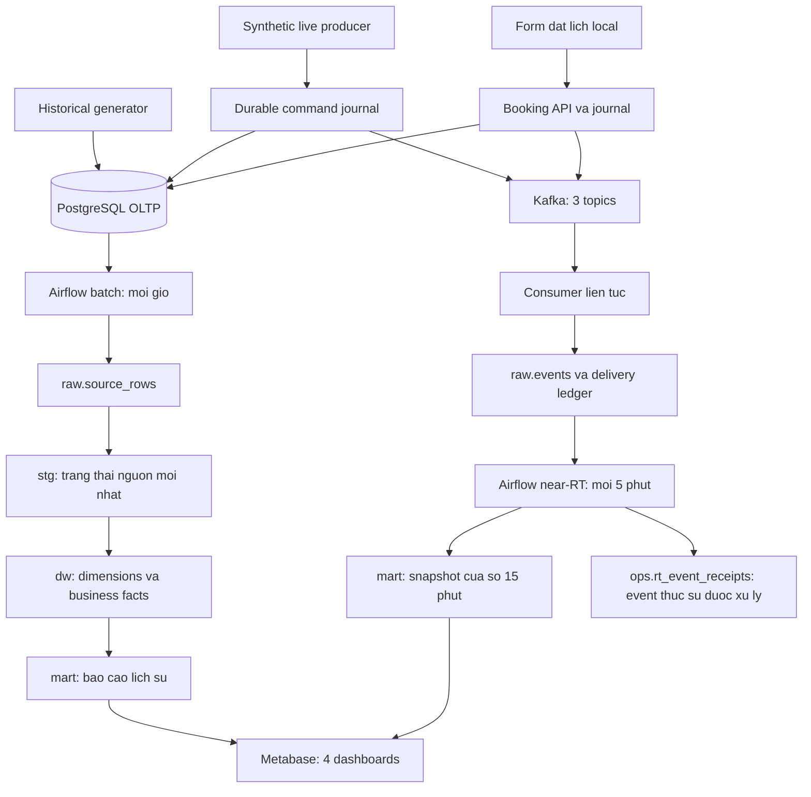
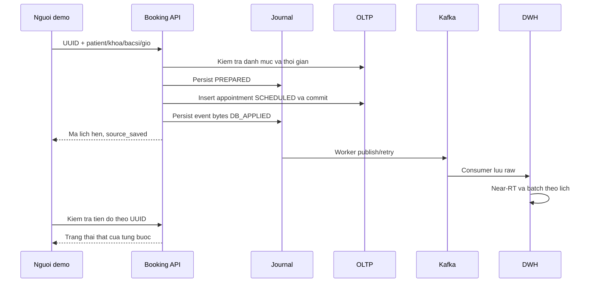

# Smart Hospital Data Warehouse — tài liệu tổng thể

## Lộ trình đọc cho người mới và mốc phiên bản

Dự án giải quyết việc tổng hợp lịch hẹn, khám bệnh, nội trú/giường và xét nghiệm thành các chỉ số có cùng cách hiểu. Có hai đường xử lý: batch xây lịch sử từ dữ liệu giao dịch; Kafka và near-RT phản ánh một số hoạt động trong 15 phút vừa qua. Form là đầu vào nghiệp vụ, không phải công cụ ghi trực tiếp vào KPI.

| Thứ tự | Tài liệu | Câu hỏi người đọc cần trả lời |
|---|---|---|
| 1 | [Phase 0](PHASE_0_FINAL.md) | Vì sao cần DW, ai dùng kết quả, 11 KPI đo điều gì? |
| 2 | [Phase 1](PHASE_1_FINAL.md) | Dữ liệu nguồn có quan hệ gì; một dòng fact đếm gì; quy tắc thời gian ra sao? |
| 3 | [Phase 2](PHASE_2_FINAL.md) | Nguồn mô phỏng, database, roles và staging được dựng thế nào? |
| 4 | [Phase 3](PHASE_3_FINAL.md) | Batch biến nguồn thành fact/mart và 9 KPI lịch sử bằng cách nào? |
| 5 | [Phase 4](PHASE_4_FINAL.md) | Kafka, cửa sổ RT và form đầu tiên bổ sung gì cho batch? |
| 6 | [Phase 5](PHASE_5_FINAL.md) | Vì sao đổi sang 5 fact/7 dimension/2 bridge; dữ liệu lớn được kiểm chứng ra sao; form và startup mới hoạt động thế nào? |
| Thực hành | [README](../README.md), [tiếp nhận](BOOKING_RECEPTION.md), [kiểm chứng](VALIDATION.md) | Chạy bản hiện tại, demo nghiệp vụ và đánh giá bằng chứng ở đâu? |

Các phase là lịch sử phát triển, không phải sáu cấu hình đang chạy đồng thời. Số fact/dimension, quy mô seed, form, cổng và lệnh cũ trong một phase chỉ đúng ở mốc đó. Mô hình hiện hành là 13 bảng nguồn phân tích, 5 fact vật lý, 7 dimension, 2 bridge, 11 KPI và 4 dashboard. Hai bảng hỗ trợ đăng ký/outbox nằm ngoài tập 13 nguồn phân tích.

Nghiệm thu Phase 5 ngày 03/11 và cập nhật form ngày 05/11/tái cấu trúc ngày 06/11 là các mốc riêng. Phần 9–12 cuối Phase 5 nối rõ thiết kế cũ với mới, mô tả đăng ký/check-in/NO_SHOW 30 phút/outbox và đường đi tới dashboard. Không dùng benchmark hoặc kiểm thử cũ để khẳng định một cập nhật mới đã được đo lại toàn bộ. Các phần bên dưới giữ chi tiết và số liệu theo mốc được ghi tại từng mục; README là nguồn hướng dẫn khởi động hiện hành.

> Cập nhật cấu trúc ngày 06/11/2026: chạy `docker compose up --build` từ thư mục gốc theo [README](../README.md). Các lệnh `scripts/` và snapshot runtime trong nội dung lịch sử bên dưới đã được thay bằng Compose gốc; module Python bảo trì chuyển sang `src/operations/`.

**Cập nhật triển khai ngày 03/11/2026, giờ Việt Nam.** Đọc tuần tự để hiểu từ nhu cầu nghiệp vụ đến dữ liệu, xử lý, kết quả và cách vận hành. Evidence Phase 5 ở artifacts/phase5; số đo Phase 2–4 thuộc bộ demo cũ và không dùng làm benchmark cho bộ mới.

Tài liệu này là điểm đọc chính của dự án. Các file PHASE_0_FINAL đến PHASE_5_FINAL giữ công việc và kết quả từng phase; roadmap là kế hoạch gốc. Không cần đọc hết các tài liệu phase trước khi đọc bản này.

## 1. Dự án giải quyết vấn đề gì?

Một bệnh nhân có thể đặt lịch, khám ngoại trú, được chỉ định xét nghiệm rồi chuyển sang điều trị nội trú. Mỗi bước tạo những bản ghi khác nhau. Nếu chỉ đếm trực tiếp trên từng bảng giao dịch, rất dễ đồng nhất số lịch hẹn với số lượt khám, dùng trạng thái giường hiện tại cho báo cáo quá khứ hoặc tính trung bình sai khi gộp nhiều khoa.

Dự án xây dựng một kho dữ liệu dùng chung để trả lời ba nhóm câu hỏi: hoạt động khám chữa bệnh diễn ra bao nhiêu; thời gian chờ, nằm viện và xét nghiệm ra sao; các hoạt động quan trọng vừa xảy ra trong 15 phút gần nhất là gì. Phần triển khai có hai nhịp: batch phục vụ phân tích lịch sử mỗi giờ, còn sự kiện qua Kafka phục vụ quan sát gần thời gian thực mỗi 5 phút.

Đây là đồ án/demo local dùng hoàn toàn dữ liệu synthetic. Mô hình Phase 5 có 13 bảng nguồn, 7 dimensions, 5 fact tables vật lý, 2 bridge tables, 11 KPI và 4 dashboard. Form local là đầu vào tương tác bổ sung cho việc đặt lịch; hệ thống chưa thay thế phần mềm vận hành bệnh viện đầy đủ.

## 2. Hiểu hành trình nghiệp vụ trước khi đọc dữ liệu

### 2.1. Đặt lịch và khám ngoại trú

`appointment` là một lịch hẹn. `encounter` là một lượt tiếp nhận/khám hoặc đợt điều trị. Bệnh nhân có thể đến theo lịch hoặc walk-in không có lịch trước. Một lịch hẹn có tối đa một encounter ngoại trú; khi đã gắn, bệnh nhân và khoa phải khớp nhau.

Các trạng thái lịch hẹn gồm SCHEDULED, ATTENDED, NO_SHOW, CANCELLED và RESCHEDULED. Theo cập nhật nghiệp vụ tiếp nhận, NO_SHOW đủ điều kiện sau 30 phút kể từ giờ hẹn. Hủy, đổi lịch và lịch chưa phân loại không tham gia mẫu số no-show. Worker đặt lịch tự chuyển các lịch được quản lý bởi form sang NO_SHOW khi quá giờ hẹn 30 phút mà chưa check-in; không phân loại lại hàng loạt dữ liệu seed.

Lượt ngoại trú có các mốc check-in, bắt đầu khám và kết thúc khám. KPI lượt khám được ghi nhận theo lúc **bắt đầu khám**, không theo lúc tạo appointment. Thời gian chờ là khoảng từ check-in đến bắt đầu khám. Bởi vậy một lịch mới trên form chưa làm tăng lượt khám hoặc check-in.

### 2.2. Nội trú và giường bệnh

Nhập viện tạo encounter INPATIENT. Nếu chuyển từ ngoại trú, encounter nội trú có ID mới và tham chiếu encounter ngoại trú qua parent_encounter_id; không đổi loại của encounter cũ. Hai lượt giữ cùng bệnh nhân và thứ tự thời gian hợp lệ.

Một đợt điều trị có thể qua nhiều lần cấp/chuyển giường. Mỗi lần nằm một giường là một khoảng thời gian riêng trong bed_assignments. Đồng thời bed_status_history ghi giường ACTIVE, MAINTENANCE hay INACTIVE theo từng khoảng. Cả hai dùng quy ước **[start, end)**: lấy thời điểm bắt đầu, không lấy thời điểm kết thúc. Nhờ vậy chuyển giường đúng thời điểm trả giường cũ không tạo overlap.

Không được cấp cùng giường cho hai encounter hoặc hai giường cho cùng encounter tại cùng thời điểm. Assignment phải nằm trong đợt nội trú và được trạng thái ACTIVE bao phủ. Báo cáo occupancy lấy đúng một ảnh chụp lúc 00:00 giờ Việt Nam, với khoa vật lý của giường.

### 2.3. Xét nghiệm

Lab order gắn với encounter và khoa yêu cầu. Luồng chính là ORDERED → COLLECTED → PROCESSING → COMPLETED; có thể hủy trước khi hoàn thành. Kết quả có thể trả sau khi bệnh nhân xuất viện, miễn timeline nghiệp vụ hợp lệ.

TAT là thời gian từ order đến có kết quả. Mục tiêu TAT được sao chép vào target_tat_minutes_at_order ngay lúc đặt order và giữ bất biến. Việc đổi mục tiêu trong danh mục về sau không sửa lại tiêu chuẩn đánh giá các order cũ.

Các hành trình và ngoại lệ trên đã có trong generator, source constraints và kiểm thử. Giao diện hiện chỉ thao tác đặt lịch; không có đủ màn hình để người dùng tự thực hiện tất cả các trạng thái nghiệp vụ.

## 3. Dữ liệu đến từ đâu, có giới hạn 150.000 dòng không?

Có ba cách đưa dữ liệu vào hệ thống: sinh snapshot lịch sử, chạy producer mô phỏng nghiệp vụ mới, hoặc gửi form đặt lịch. **151.433 dòng là seed ban đầu, không phải trần dung lượng.**

Generator Phase 5 lấy **6.000 lượt khám/ngày × 180 ngày = 1.080.000 encounter**, gồm cả OP và IP. Khoảng ngày Việt Nam được khóa trong manifest; các bảng khác suy từ tỷ lệ nghiệp vụ và nhu cầu giường, không ép tổng thành 5 triệu dòng. Generator ghi CSV theo chunk, hash tăng dần và dùng SQLite tạm trên đĩa container; loader dùng COPY với receipt để tiếp tục sau lỗi. Manifest và evidence có bản sao tại artifacts/phase5, còn CSV ở artifacts/generated và không được đóng gói.

Bảng dưới là **seed demo Phase 2 cũ** từ 22/10/2025 đến trước 22/10/2026, seed 20261022. Bộ này được backup và giữ riêng; không so tốc độ trực tiếp với bộ Phase 5.

| Bảng nguồn | Một dòng biểu diễn | Số dòng seed |
|---|---|---:|
| patients | Một bệnh nhân synthetic | 10.000 |
| departments | Một khoa | 10 |
| doctors | Một bác sĩ thuộc khoa | 100 |
| appointments | Một lịch hẹn | 50.000 |
| encounters | Một lượt ngoại trú hoặc đợt nội trú | 54.000 = 50.000 OP + 4.000 IP |
| beds | Một giường vật lý | 240 |
| bed_status_history | Một khoảng trạng thái giường | 280 |
| bed_assignments | Một khoảng cấp giường | 4.795 |
| lab_test_types | Một loại xét nghiệm | 8 |
| lab_orders | Một chỉ định xét nghiệm | 32.000 |
| **Tổng** | **10 bảng nghiệp vụ** | **151.433** |

Sau producer, form và các acceptance tests, số dòng thực tế tăng lên. Chẳng hạn lần nghiệm thu form ghi thêm appointments 50002 và 50003. Không dùng số seed để kết luận database hiện tại vẫn chỉ có từng ấy dòng.

Seed có cơ chế không ghi đè: cùng ID nhưng khác nội dung bị từ chối thay vì khôi phục trạng thái nguồn về dữ liệu cũ. Các sequence được đồng bộ để lần insert tiếp theo lấy ID mới. Vì vậy không chạy lại seed gốc để sửa một hệ thống đã có dữ liệu phát sinh.

## 4. Kiến trúc tổng thể và trách nhiệm của từng lớp



OLTP là dữ liệu nghiệp vụ chính. DWH là database phân tích riêng, gồm các schema sau:

Kiến trúc lưu trữ và truy vấn phân tích là **ROLAP trên PostgreSQL**. Mô hình **fact constellation (galaxy schema)** có 5 facts dùng chung 7 dimensions và 2 bridges. “Hybrid batch/near-RT” mô tả hai nhịp xử lý; không có cube MOLAP hoặc kiến trúc HOLAP trong triển khai này.

| Lớp | Nội dung và lý do tồn tại |
|---|---|
| raw | Giữ bản ghi được trích xuất và sự kiện nhận được để có lineage, đối soát và truy vết |
| stg | Bảng typed/latest theo khóa nguồn, thuận tiện làm sạch và xây dựng mô hình |
| dw | Dimensions dùng chung và facts có grain rõ ràng |
| mart | Views/snapshots phục vụ KPI và dashboard, giảm việc BI phải tự suy diễn nghiệp vụ |
| ops | Run audit, watermarks, DQ, quarantine, reconciliation và lịch sử refresh |
| _deploy | Migration name/checksum, ngăn sửa âm thầm DDL đã áp dụng |

Batch và streaming cùng nhìn một nghiệp vụ nhưng phục vụ những mục đích khác nhau. Không cộng số event vào số lượt khám lịch sử. Lịch sử lấy business facts; RT lấy loại sự kiện và cửa sổ đã quy định.

**Hiện chưa có CDC/Debezium.** Producer và booking chủ động ghi nguồn rồi phát event. Nếu sửa OLTP trực tiếp bằng SQL, batch có thể nhận thay đổi, nhưng Kafka không tự phát một event tương ứng.

## 5. Hạ tầng đã triển khai

| Thành phần | Cấu hình đang dùng | Vai trò |
|---|---|---|
| PostgreSQL | 16.15; OLTP, DWH và metadata server riêng | Lưu giao dịch, phân tích và metadata ứng dụng |
| Python | 3.12.15 trong foundation image | Generator, batch job, producer/consumer, booking và BI provisioning |
| Airflow | 3.1.8, LocalExecutor, parallelism 2 | Lập lịch, retry, theo dõi batch/near-RT |
| Kafka | 3.9.1, KRaft, một broker | Truyền sự kiện nghiệp vụ |
| Metabase | 0.64.1 | Saved questions, bộ lọc và 4 dashboard |
| Docker Compose | smart_hospital_dw_phase5; demo cũ smart_hospital_dw | Cô lập code snapshot, secrets, network, cổng và volumes |

Airflow có API server, scheduler và DAG processor. Airflow init là tác vụ khởi tạo có thể kết thúc với exit 0; không cần giữ chạy. Metadata PostgreSQL có hai database riêng cho Airflow và Metabase. Foundation là service công cụ chạy theo lệnh, không phải daemon bắt buộc luôn hoạt động.

Image nền được khóa bằng digest trong .env.example; custom images và version evidence ở infrastructure. Dependencies Python có requirements.lock.txt. Code được mount read-only, còn artifacts và journal có nơi ghi riêng. Database, Kafka, logs và hai journal có named volumes để giữ dữ liệu qua restart.

Stack Phase 5 bind 127.0.0.1: OLTP56432, DWH56433, Kafka29092, Airflow28080, Metabase23000, booking28081. Demo cũ giữ cổng 55432/55433/19092/18080/13000/18081 và volumes riêng. Metadata server không xuất cổng host. Trong container dùng service name và cổng nội bộ, ví dụ postgres-oltp:5432.

## 6. Nguồn OLTP được bảo vệ như thế nào?

DDL có PK/FK, trạng thái hợp lệ, checks về timeline và exclusion constraints chống overlap giường. Trigger bảo vệ PK và created_at, bảo vệ khoa sở hữu ở các bảng được chỉ định, đóng băng lab target và cập nhật updated_at khi sửa nguồn. Physical DELETE bị chặn; nghiệp vụ dùng trạng thái/inactive để lưu dấu vết.

Các kiểm tra liên bảng như cùng bệnh nhân khi OP→IP, ACTIVE coverage đầy đủ và quan hệ appointment/encounter cần thêm source validator/DQ. Constraint một bảng không tự chứng minh toàn bộ hành trình đúng. Pipeline kiểm tra trước khi công bố dữ liệu phân tích.

Quyền thường dùng gồm hospital_writer/hospital_reader ở nguồn, hospital_etl/hospital_consumer ở DWH và hospital_reporter cho BI. Reporter chỉ đọc mart/safe views. Bootstrap dùng quyền admin để tạo schema và grants. Secrets nằm trong .env local, không ghi vào docs, Git hoặc gói bàn giao.

## 7. Đường batch: từ giao dịch đến kho lịch sử

### 7.1. Trình tự một lần chạy

1. DAG hospital_batch gọi Python job, lấy advisory lock để tránh hai batch cùng merge.
2. Nguồn được đọc trong một snapshot REPEATABLE READ READ ONLY. Clock OLTP xác định thời điểm quan sát; business cutoff bằng source_now trừ120 giây.
3. Với mỗi bảng, đóng băng upper bound là bộ lớn nhất (updated_at, PK). Lần incremental đọc lại từ watermark.updated_at trừ120 phút đến upper bound. Initial/backfill đọc toàn phạm vi nguồn.
4. Lưu các row được chọn vào raw.source_rows với batch_id, khóa nguồn, source_updated_at, extracted_at và payload. Upsert stg theo PK để giữ trạng thái mới nhất.
5. Chạy SQL DQ trên toàn nguồn, kiểm tra transition và đối soát đủ khóa/payload của 13 bảng với staging bằng server cursor và ordered hash streams.
6. Nạp dimensions, restate business facts và snapshot/marts; kiểm tra số lượng và ghi audit/DQ.
7. Commit dữ liệu phân tích và watermark cùng một transaction DWH. Chỉ lúc này kết quả mới được công bố.

**120 phút lookback** phục vụ trích xuất lại thay đổi kỹ thuật; **120 giây business cutoff** phục vụ điều kiện nghiệp vụ theo thời gian. Đây là hai cơ chế khác nhau, không phải việc trì hoãn mọi row mới hai phút.

### 7.2. Incremental ở đâu, restate ở đâu?

Extract có watermark/lookback để chọn phần thay đổi. Tuy nhiên ở quy mô local, mỗi run vẫn đọc toàn nguồn để kiểm tra và đối soát; dimensions/business facts được restate từ staging hiện hành. Cách làm này đơn giản hóa việc xử lý corrections và phụ thuộc giữa encounter, lab, bed assignment.

Do đó chưa thể gọi toàn bộ pipeline là xử lý tăng dần tối ưu cho dữ liệu lớn. Đây là lựa chọn triển khai đã kiểm chứng ở quy mô đồ án. Backfill có start/end chỉ giới hạn vùng tính lại **bed snapshot**; các business facts còn lại vẫn được restate đầy đủ.

### 7.3. Khi lỗi hoặc chạy lại

Nếu lỗi trước commit, raw/stg/warehouse/watermarks và success audit của transaction bị rollback. Một transaction khác lưu run FAILED, DQ_GATE FAIL và quarantine kèm thông tin lỗi/payload thu được. Không tiếp tục publish phần batch còn lại như thể toàn bộ đã hợp lệ.

Merge theo business key và unique grain giúp retry/rerun không nhân appointment, encounter hay lab order. Sửa hồi tố nguồn có updated_at mới; job chạy lại sẽ phản ánh corrections, kể cả ảnh hưởng snapshot cũ. Normal run chặn transition quan sát không hợp lệ; backfill bỏ so sánh transition cũ nhưng vẫn giữ các kiểm tra chất lượng khác.

## 8. Warehouse: mỗi bảng đang đếm cái gì?

**Grain** là ý nghĩa của một dòng. Xác định grain trước giúp tránh join một encounter với nhiều lab orders rồi vô tình đếm encounter nhiều lần.

| Dimension | Grain và lịch sử |
|---|---|
| dim_date | Một ngày lịch Việt Nam; date_key dạng YYYYMMDD |
| dim_patient | Một bệnh nhân, thuộc tính hiện hành — SCD1 |
| dim_department | Một khoa, thuộc tính hiện hành — SCD1 |
| dim_doctor | Một bác sĩ × một phiên bản hiệu lực đã quan sát — SCD2 |
| dim_bed | Một giường — SCD1 |
| dim_lab_test_type | Một loại xét nghiệm — SCD1 |
| dim_diagnosis | Một mã chẩn đoán synthetic ổn định — mô tả SCD1, chưa tuyên bố là ICD |

Surrogate key là khóa nội bộ kho, tách với business ID của nguồn. Khóa0 là unknown. Doctor SCD2 chỉ có lịch sử từ khi hệ thống quan sát thay đổi; không bịa phiên bản trước bootstrap. Fact có thời điểm nghiệp vụ trước khoảng doctor coverage dùng doctor_sk0 và vẫn giữ doctor_id để truy vết. Khoa nghiệp vụ lấy từ row nguồn, không suy ngược từ khoa hiện tại của doctor.

| Fact | Grain | Phục vụ |
|---|---|---|
| fact_appointment | Một appointment | Trạng thái lịch hẹn, no-show |
| fact_encounter | Một encounter_id có encounter_type OP/IP | Lượt khám, thời gian chờ, nhập viện và LOS theo vai trò ngày riêng |
| fact_bed_assignment | Một khoảng cấp giường | Truy vết sử dụng/chuyển giường |
| fact_bed_snapshot_daily | Một giường × một ngày tại00:00 | Occupancy theo thời điểm |
| fact_lab_order | Một lab order | Throughput, TAT và đúng hạn |

Hai bridge là bridge_encounter_doctor và bridge_encounter_diagnosis, grain theo association_id nguồn. Doctor bridge giữ doctor_id và phiên bản doctor_sk tại joined_at; thiếu coverage giữ SK0. Quan hệ được sửa/void vẫn có dấu vết và được cập nhật khi rerun. Fact giữ owning department; bác sĩ phối hợp khác khoa không đổi khoa lượt khám.

Lọc đồng thời bác sĩ và chẩn đoán bằng EXISTS/semi-join như mart.encounters_by_doctor_diagnosis; một encounter có 2 bác sĩ và 3 chẩn đoán vẫn tính một lượt. Các tên fact_outpatient_encounter và fact_inpatient_encounter chỉ còn compatibility views tạm, không phải bảng fact vật lý.

Calendar dimension được mở rộng đến ngày hẹn tương lai lớn nhất để booking xa hơn ngày mai không lỗi FK. Điều đó không tạo bed snapshot cho ngày chưa đến: snapshot vẫn giới hạn theo business cutoff.

Các daily mart giữ thành phần tổng/count để Metabase gộp nhiều ngày hoặc khoa trước rồi mới chia. Lỗi thời gian chờ không được tự biến thành0 phút; eligibility cho lượt khám, waiting, TAT và throughput được tách phù hợp.

## 9. Đường streaming: từ hành động mới đến cửa sổ 15 phút

### 9.1. Event contract và Kafka

| Topic | Key | Event types |
|---|---|---|
| appointments.events | appointment_id | created, status_changed |
| encounters.events | encounter_id | checked_in, consultation_started, admitted, bed_assigned, bed_released, discharged |
| laboratory.events | lab_order_id | order_created, sample_collected, processing_started, result_completed, cancelled |

Có13 event types trên3 topics, mỗi topic3 partitions. Envelope gồm event_id UUID, event_type, entity_id, schema_version1.0.0, event_time, published_at, source_system và payload. Source_system hiện là hospital_simulator, kể cả booking synthetic. Consumer bổ sung metadata Kafka và ingested_at; không sửa body canonical.

event_time là lúc nghiệp vụ xảy ra, published_at là mốc phát đã được cố định, còn ingested_at là khi DWH nhận. Ba mốc không thay thế cho nhau. Không có bảo đảm thứ tự giữa các keys/topics. Broker local có retention7 ngày, replication factor1, không HA.

### 9.2. Journal bảo vệ khoảng cách giữa SQL và Kafka

Producer ghi PREPARED vào SQLite journal trước mutation, gồm command, ID nguồn và event UUID/payload cố định. Sau SQL commit, producer lưu immutable message bytes/published_at và chuyển DB_APPLIED; broker ACK rồi mới đánh dấu PUBLISHED. Journal dùng WAL, synchronous FULL và file lock cho một writer trên mỗi journal.

Crash sau source commit được khôi phục bằng so after-image với source, tránh insert lại. Nếu không khớp, giữ conflict để đối soát thay vì đoán rằng nghiệp vụ đã thành công. Crash sau ACK nhưng trước mark có thể gửi lại cùng UUID/body. Consumer chịu trách nhiệm dedup lần gửi lại đó.

Producer và booking dùng hai journal volumes riêng. Đây là cơ chế phục hồi của demo, **không phải transaction nguyên tử PostgreSQL+Kafka hoặc exactly-once toàn hệ thống**. Phương thức reconciliation của journal có thể gửi lại tín hiệu đã publish nhưng thiếu trong raw; chưa có một dịch vụ reconciliation định kỳ độc lập.

### 9.3. Consumer xác nhận dữ liệu trước offset

Consumer chạy liên tục với group hospital-raw-v1, tắt auto-commit/auto-store. Nó kiểm tra JSON Schema, topic/key/entity, nguồn có tồn tại, context bệnh nhân/khoa/encounter, milestone timestamp và độ lệch tương lai tối đa30 giây theo clock OLTP.

raw.events giữ một canonical event theo UUID. raw.event_deliveries giữ từng vị trí (topic, partition, offset), bao gồm duplicate và malformed deliveries. Cùng UUID cùng body là duplicate; cùng UUID khác body bị quarantine. UUID khác nhau vẫn có thể trỏ cùng entity, nên RT còn phải distinct theo entity nghiệp vụ.

Raw/delivery/quarantine được ghi bền vững trong DB trước khi consumer commit offset Kafka đồng bộ. JSON/schema/ngữ nghĩa sai được quarantine rồi mới tiến offset. Lỗi DB/mạng làm rollback và chưa commit offset để có thể xử lý lại.

### 9.4. Near-RT publish một snapshot nhất quán

DAG hospital_near_rt lấy clock DWH làm as_of, đọc canonical raw.events trong cùng snapshot REPEATABLE READ và công bố snapshot mọi khoa cùng transaction với ops.rt_event_receipts. Receipt chỉ ghi các tín hiệu thực sự được tính. Window là **(as_of−15 phút, as_of]**, đồng thời ingested_at≤as_of. Dashboard chỉ đọc một as_of đã công bố.

Event đến muộn vẫn được lưu để audit; nó được tính nếu còn nằm trong cửa sổ ở lần refresh sau. Event quá cũ không làm tăng RT hiện tại. Khi không có sự kiện mới, DAG vẫn refresh để số đếm hết hạn về0. Booking.created được lưu raw nhưng form báo “không áp dụng cho KPI RT”; warehouse_received dựa trên fact_appointment.

## 10. Mười một KPI và cách đọc đúng

| KPI | Công thức/điều kiện chính | Vai trò ngày |
|---|---|---|
| OP01 | Số OP encounter đã bắt đầu khám, gồm walk-in | Ngày bắt đầu khám |
| OP02 | Tổng phút check-in→bắt đầu khám hợp lệ / số mẫu hợp lệ | Ngày bắt đầu khám |
| OP03 | 100×NO_SHOW/(ATTENDED+NO_SHOW) đủ điều kiện; grace30m | Ngày hẹn |
| IP01 | Số IP encounter có admission hợp lệ | Ngày nhập viện |
| IP02 | 100×giường ACTIVE đang có người / số giường ACTIVE tại cùng snapshot | Một ngày chọn, lúc00:00 |
| IP03 | Tổng ngày thực admission→discharge / số discharge hợp lệ | Ngày xuất viện |
| LAB01 | Số lab orders COMPLETED có kết quả hợp lệ | Ngày có kết quả |
| LAB02 | Tổng phút order→result hợp lệ / số mẫu hợp lệ | Ngày có kết quả |
| LAB03 | 100×orders có TAT≤target đã đóng băng / số mẫu target hợp lệ | Ngày có kết quả |
| RT01 | Distinct encounter có checked_in trong cửa sổ15 phút | Event-time/as_of |
| RT02 | Distinct lab order có result_completed trong cùng cửa sổ | Event-time/as_of |

KPI batch chỉ nhận các mốc đủ điều kiện tới business cutoff. Mẫu số0 trả NULL/N/A. Occupancy có snapshot invalid cũng trả N/A thay vì một tỷ lệ có vẻ hợp lệ. Đúng ngưỡng TAT vẫn được tính đúng hạn.

Ví dụ khoa A có1/1 xét nghiệm đúng hạn, khoa B có1/9: kết quả chung là2/10=20%, không phải trung bình của100% và11,11%. Tương tự, waiting/TAT/LOS phải gộp tổng duration và số mẫu trước khi chia.

IP02 là ảnh chụp thời điểm, không phải bed-day hay tỷ lệ trung bình cả ngày. RT01 là check-in, không phải OP01; booking SCHEDULED chưa thuộc mẫu số no-show. Các phân biệt này giữ nhất quán từ source tới BI.

## 11. Dashboard đang trình bày những gì?

| Dashboard hiện có | Nội dung |
|---|---|
| Executive Overview — /dashboard/2 | OP01, IP01, IP02, LAB01 và các xu hướng theo ngày |
| Outpatient Operations — /dashboard/3 | OP01–03, waiting và no-show theo ngày |
| Inpatient & Bed Management — /dashboard/4 | IP01–03, admission/LOS, giường theo snapshot |
| Laboratory & Real-Time — /dashboard/5 | LAB01–03, RT01/02, cửa sổ và freshness |

Metabase đọc mart bằng reporter, không truy vấn OLTP để thay thế warehouse. Saved questions, layout và bindings filter được provision bằng code. Dashboard có ngày/khoa phù hợp; occupancy dùng ngày snapshot riêng. Phase 5 lấy historical defaults từ manifest:06/05/2026–01/11/2026; RT dùng as_of riêng. Các IDs trong bảng đã được xác nhận cho Phase 5, mở tại http://localhost:23000; cấu hình chi tiết ở artifacts/phase5/dashboards.json.

Refresh trang/dashboard chỉ chạy lại truy vấn trên dữ liệu đã publish, không tự chạy ETL. URL refresh60 giây không biến DAG5 phút thành realtime từng giây. Với booking tương lai, dù fact đã có trong DW,11 KPI hiện tại vẫn không tăng vì chưa có khám/check-in/kết quả xét nghiệm và bộ lọc lịch sử còn là năm seed.

## 12. Form đặt lịch: một ví dụ đầu vào đến đầu ra

Mở **http://localhost:28081** cho Phase 5. Form lấy danh mục thật từ nguồn, gợi ý mã bệnh nhân như SYN-00000001, lọc bác sĩ theo khoa và hiển thị giờ Việt Nam. Chọn một giờ tương lai tối đa365 ngày rồi gửi.



API kiểm tra patient đang hoạt động, doctor/khoa hoạt động và thuộc nhau, giờ có timezone và nằm trong giới hạn. Không nhận họ tên/điện thoại/hồ sơ bệnh án thật. POST thành công xác nhận nguồn đã lưu, không đợi tất cả các bước phân tích hoàn thành.

| Mốc trên form | Điều được xác nhận |
|---|---|
| Source saved | Appointment tồn tại trong OLTP |
| Broker acknowledged | Kafka ACK và journal đã mark publish |
| Raw received | Canonical event đã được consumer lưu |
| Xử lý KPI RT | Không áp dụng cho booking.created; receipt chỉ dùng cho checked_in/result_completed thực sự được snapshot sử dụng |
| Warehouse received | Appointment đã vào business fact qua batch |

Trình duyệt lưu UUID và payload trong localStorage. Retry gửi lại cùng nội dung; reload đọc tiến độ thay vì tự tạo lịch mới. Cùng UUID khác nội dung trả409. Nút Đặt lịch mới tạo một request mới có chủ đích. Form poll4 giây tối đa5 phút, sau đó có nút kiểm tra lại vì batch có thể chưa tới giờ.

Endpoints gồm GET /, GET /health, GET /api/catalogs, POST /api/bookings và GET /api/bookings/{request_id}. Health xác nhận process chạy; không phải bằng chứng toàn pipeline đã đồng bộ. DWH không truy cập được thì trạng thái phân tích có thể chưa biết, không phủ nhận appointment đã commit.

Worker thử pending mỗi3 giây. Một command conflict được giữ lại để đối soát, không chặn mọi command khác. Host/Origin được kiểm tra, POST chỉ nhận JSON tối đa8KB và cổng chỉ local. UUID là khóa tra cứu tiến độ; chưa có tài khoản bệnh nhân/xác thực nghiệp vụ production.

Demo hiện chưa có đăng ký bệnh nhân mới, quản lý slot/sức chứa hoặc lịch làm việc bác sĩ, đổi/hủy lịch, check-in UI hay Google Forms. Chọn cùng bác sĩ/giờ khác request chưa phải một hệ thống đặt slot có kiểm soát năng lực phục vụ.

## 13. Đã kiểm chứng đến đâu?

Các số đo trong mục này thuộc bộ demo Phase 2–4. Kết quả Phase 5, live tail và benchmark cùng dữ liệu được ghi riêng trong artifacts/phase5; không tái sử dụng latency cũ làm số đo của bộ mới.

| Nhóm | Bằng chứng đã có |
|---|---|
| Thiết kế và generator | 34 checks thiết kế;6 generator unit tests |
| Nguồn |5 negative DB tests: FK, status, timeline, overlap và frozen target |
| Warehouse/KPI |28 SQL fixture assertions cho9 historical KPI |
| Batch recovery |Rollback watermark, rerun, observed doctor SCD2, correction snapshot cũ, bounded snapshot backfill |
| DQ gate |Lỗi liên bảng bị chặn/quarantine; sửa nguồn và chạy lại thành công |
| Streaming |Crash sau SQL commit, broker lỗi, duplicate/conflict, malformed bytes, late/reverse order, restart và replay1076 positions an toàn |
| Cửa sổ RT |4 SQL checks về boundary, distinct, future/ingest cutoff và idle expiry |
| Dashboard |Queries, scalar values, date/khoa filters và saved layout kiểm tra qua API |
| Booking |HTTP→OLTP→Kafka→raw→facts;14 Python unit tests tổng cộng, JS mock DOM,4 retry đồng thời thành1 appointment; restart giữ journal |
| Regression sau booking |9 historical KPI đối soát OLTP đúng; consumer lag0 tại lần kiểm tra |

Latency đã đo100 tín hiệu KPI từ **một burst50 OP/lab journeys, tổng300 events**:100/100 thấy qua Metabase API, không timeout, p50=p95=222,68 giây so với target600 giây. DAG5 phút chạy theo lịch, observer gọi API mỗi5 giây; không manual refresh trong phép đo này. Cùng burst thấy ở một lần poll nên p50 và p95 bằng nhau, không phải thống kê nhiều mức tải độc lập.

Mốc đầu là query clock nguồn gán published_at; elapsed dùng monotonic cùng process. Mốc cuối là lần API đầu tiên trả event từ snapshot hiện hành. **Chưa đo browser render hoặc SLA riêng cho từng form.** Acceptance booking có trigger batch/near-RT thủ công để xác minh đường đi; không dùng nó thay cho phép đo scheduled latency.

Windows và Docker/WSL từng lệch/nhảy khoảng90 giây; phép trừ UTC thuần không tin cậy, sai khác lớn nhất89,77 giây. Airflow đang dùng JWT leeway120 giây và vẫn bật xác thực. Producer dùng clock nguồn và có trì hoãn khi clock lùi; hệ thống chưa có biện pháp đồng bộ clock bền vững.

Evidence chính nằm ở artifacts/phase1 đến phase4: validation_report, runtime/idempotent_rerun, sql_fixtures, batch_recovery, dq_gate, streaming_failure_tests, window_sql_tests, dashboards/dashboard_reconciliation, latency_measurements JSON/CSV, booking_demo và booking_validation. Có cả failure injection/quarantine được giữ để truy vết; không xóa lỗi thử nghiệm để làm đẹp kết quả. Hình thức kiểm tra giao diện hiện là API/HTTP/JS, chưa có browser screenshot/render QA.

## 14. Vận hành và dựng lại Phase 5

Chạy PowerShell tại D:\Project\BTL_DW, dùng Docker Desktop Linux engine. Stack Phase 5 có code snapshot, secrets và volumes riêng. Không chạy seed lại để sửa database đã có dữ liệu nghiệp vụ.

```powershell
# Tạo cấu hình/snapshot riêng; giữ nguyên snapshot nếu đã tồn tại.
./scripts/phase5_run.ps1 -Action prepare
# Database mới: tạo role/migrations, sinh và nạp nguồn.
./scripts/phase5_run.ps1 -Action setup
./scripts/phase5_run.ps1 -Action generate
./scripts/phase5_run.ps1 -Action load
./scripts/phase5_run.ps1 -Action batch
# Bật giao diện và các dịch vụ local; DAG definitions tạo ở trạng thái paused.
./scripts/phase5_run.ps1 -Action start-ui
./scripts/phase5_run.ps1 -Action dashboards
# Refresh thủ công để demo; đây không phải phép đo scheduled latency.
./scripts/phase5_run.ps1 -Action refresh
# Xuất evidence, dừng riêng stack và giữ volumes.
./scripts/phase5_run.ps1 -Action export-evidence
./scripts/phase5_run.ps1 -Action stop
```

Đã có dữ liệu thì chỉ cần start-ui; không generate/load để reset nguồn. Muốn cập nhật code snapshot có chủ đích, dùng scripts/phase5_prepare.ps1 -RefreshCode sau khi dừng/drain jobs. Migrations cũ được kiểm checksum; thay đổi DDL bằng migration mới. Nguồn được bảo vệ khỏi physical DELETE và loader từ chối dataset khác/nonempty không có receipt.

Cấu hình bench ở artifacts/generated/phase5_runtime/code/.env. Không in secrets qua docker compose config hoặc đưa vào Git/gói. Secrets được sinh bằng RNG, kiểm placeholder và không dùng chung với demo. PostgreSQL bench có /dev/shm256MiB để vượt lỗi shared-memory đã quan sát trước baseline; Docker báo khoảng15,22GiB RAM và16 logical CPUs trong môi trường kiểm chứng này.

Benchmark cần dừng producers/DAGs, khóa corpus RT còn tín hiệu ở một as_of thực tế, rồi dùng benchmark-before/benchmark-after. Harness ghi lần đầu riêng, warm-up3 lần và20 mẫu; timeout/error được giữ, kèm result digests và EXPLAIN plans. Chỉ so sánh khi dataset/query/settings/corpus bằng nhau. Số đo SQL không phải browser render time.

Unit/design/UI checks không thêm nghiệp vụ; integration/live/recovery harness có thể thêm dữ liệu vào các database synthetic được nêu trong từng file. Không coi mutation test là health check. scripts/package_delivery.py loại secrets, generated CSV và DB dumps; gói code không thay thế backup PostgreSQL.
## 15. Kịch bản demo tuyến tính

1. Mở Airflow và xem hai manual runs nghiệm thu thành công. Hai DAG hiện paused=true theo trạng thái đã lưu; bật lịch khi muốn demo tự động hoặc dùng lệnh thủ công ở mục14. Mở4 dashboard để giới thiệu dữ liệu seed và đúng date range.
2. Chọn một khoa/ngày trên historical dashboard, giải thích lượt khám khác lịch hẹn; chỉ ra occupancy là snapshot và LAB đúng hạn dùng frozen target.
3. Mở form localhost28081, dùng bệnh nhân mẫu, chọn khoa/bác sĩ và giờ khám tương lai. Gửi một lần, ghi lại mã appointment, chỉ ra Source saved.
4. Xem lần lượt broker ACK/raw received. Reload cùng trang để chứng minh giữ request; không nhấn Đặt lịch mới khi chỉ muốn xem lại.
5. Chờ lịch DAG hoặc chạy batch và near-RT thủ công như mục14 để thấy fact_appointment được cập nhật. Nói rõ khi đang tăng tốc phần demo bằng trigger tay.
6. Giải thích vì sao KPI lượt khám/check-in chưa tăng. Muốn minh họa hai KPI RT, chạy producer tạo OP/lab thật theo contract:

```powershell
$phase5Code = Join-Path (Get-Location) 'artifacts/generated/phase5_runtime/code'
$composeArgs = @('-p','smart_hospital_dw_phase5','--env-file',
    (Join-Path $phase5Code '.env'),'-f',
    (Join-Path $phase5Code 'infrastructure/docker-compose.yml'),'-f',
    (Join-Path $phase5Code 'infrastructure/phase5.override.yml'))
docker compose @composeArgs run --rm --no-deps --entrypoint python foundation -m streaming.producer --count 1 --full-journey
```

Lệnh trên **tạo thêm nghiệp vụ synthetic** gồm hành trình có đủ13 loại event; không phải cập nhật chính appointment vừa gửi form. Sau near-RT refresh, xem RT01/RT02 và as_of. Khi cửa sổ hết hạn mà không có event mới, các số RT sẽ trở lại0.

## 16. Cấu trúc thư mục và điểm tra cứu

```text
BTL_DW/
├── README.md
├── src/
│   ├── data_sources/generator/   # Snapshot lịch sử
│   ├── data_quality/             # Kiểm tra nguồn liên bảng
│   ├── batch_pipeline/
│   │   ├── dags/                 # hospital_batch, hospital_near_rt
│   │   └── jobs/                 # Batch và near-RT implementation
│   ├── streaming/
│   │   └── contracts/            # JSON Schema và sample events
│   ├── analytics/                # Metabase setup và provisioning
│   └── booking/                  # API và giao diện local
├── sql/
│   ├── design/                   # Source/raw/ops/DW DDL và KPI functions
│   └── warehouse/
│       ├── ddl/                  # SQL helpers đã migrate
│       └── transformations/      # Batch transformation
├── infrastructure/               # Compose, Dockerfiles, image/version locks
├── scripts/                      # Bootstrap, config, validator, ops, packaging
├── tests/
│   └── fixtures/                 # Dữ liệu có đáp án cho kiểm tra
├── artifacts/
│   ├── phase1/ ... phase5/       # Evidence theo phase
│   └── generated/                # Snapshot lớn, không đưa vào Git/gói
└── docs/
    ├── PROJECT_GUIDE.md          # Tài liệu đang đọc
    ├── PHASE_0_FINAL.md ... PHASE_5_FINAL.md
    ├── PHASE_2_3_4_EXECUTION_ROADMAP.md
    ├── FULL_ACCESS_ACTIVITY_LOG.md
    └── diagrams/                 # ERD nguồn và star schema Mermaid
```

Để theo một record, đọc lần lượt src/booking/service.py hoặc src/streaming/producer.py → scripts/foundation.py để hiểu kết nối/nguồn → src/streaming/consumer.py hoặc src/batch_pipeline/jobs/batch.py → SQL transformation/KPI → src/analytics/provision.py. Định nghĩa cột/constraint xem DDL, không dựa vào tên Python biến.

Một số tên DDL vẫn có chữ draft/design từ Phase1, nhưng nội dung đã được migrate và kiểm thử runtime. Đổi tên thư mục không đổi tên migration, nội dung/checksum SQL hoặc tên module CLI. Docker đặt PYTHONPATH=/app/src:/app và Airflow đọc DAG ở /app/src/batch_pipeline/dags.

## 17. Tiến trình đã làm và giới hạn còn lại

Phase0 chốt bài toán/phạm vi/KPI; Phase1 thiết kế và thử logic; Phase2 dựng runtime/nguồn/ingestion; Phase3 xây batch/DW/historical BI; Phase4 xây Kafka/near-RT, bổ sung booking local và kiểm chứng đường đi. Phase5 đã triển khai mô hình 5/7/2, dữ liệu từ 6.000 lượt/ngày ×180 ngày, đối soát, benchmark và hai DAG thực tế. Trạng thái nghiệm thu recovery sau cùng được ghi trong báo cáo Phase5 và gates.json.

Đợt tái cấu trúc ngày23/10/2026 gom sáu package vào src, SQL warehouse vào sql/warehouse và fixtures vào tests/fixtures; giữ CLI cũ. README rút gọn thành điểm vào, bỏ hai README rời đã lỗi thời và ba script sinh tổng kết phase dùng một lần. Tám file SQL được giữ nguyên bytes/checksum, .env và bảy named volumes được giữ. Có snapshot code trước thay đổi để đối chiếu; snapshot không chứa secrets hoặc backup volume.

Sau chuyển, cả hai DAG chạy thật thành công từ đường dẫn mới,14 unit tests,28 SQL assertions,34 design checks và JS behavior test đạt;16 kiểm tra dashboard API và9 KPI đối soát đạt. Form đọc lại appointment cũ được, không seed hoặc tạo bệnh nhân/lịch hẹn mới trong đợt tái cấu trúc. Evidence ở artifacts/maintenance/restructure.json và restructure_validation.json. Các kết quả này kiểm tra tương thích sau đổi thư mục, không thay thế giới hạn browser/latency đã nêu.

Các giới hạn đã biết gồm clock Windows/WSL, chưa browser render QA, chỉ một máy/một broker, chưa HA/cloud, chưa CDC, full-source validation và full fact restatement, SCD2 chỉ có lịch sử quan sát, reconciliation journal chưa có daemon định kỳ, form chỉ cho bệnh nhân mẫu và chưa quản lý năng lực slot. Git local đã được tạo; chưa có remote/GitHub publish.

Các hướng nâng cấp tương ứng là đồng bộ clock bền vững; UI QA trên browser; thử tải arrival-rate/coexistence dài hạn; HA/khôi phục Kafka trên broker mới; CDC hoặc outbox transaction ở nguồn; tối ưu incremental theo phụ thuộc; reconciliation định kỳ; xác thực và quy tắc slot khi mở rộng booking. Backup/restore PostgreSQL và journals có helper và evidence riêng; trạng thái nghiệm thu đầy đủ của bộ Phase5 được ghi tại mục18.

Hồ sơ chi tiết: [Phase0](PHASE_0_FINAL.md), [Phase1](PHASE_1_FINAL.md), [Phase2](PHASE_2_FINAL.md), [Phase3](PHASE_3_FINAL.md), [Phase4](PHASE_4_FINAL.md), [Phase5](PHASE_5_FINAL.md), [roadmap gốc](PHASE_2_3_4_EXECUTION_ROADMAP.md) và [nhật ký thao tác](FULL_ACCESS_ACTIVITY_LOG.md).

## 18. Phase 5 — mô hình và bộ dữ liệu mới

Mô hình hiện tại có 5 fact tables vật lý, 7 dimensions và 2 bridges. Quy mô nguồn được tính từ 6.000 lượt khám/ngày trong 180 ngày, tổng 1.080.000 encounter (OP+IP); 10 bảng chính có 5.099.999 dòng, 13 bảng nguồn có 7.931.367 dòng. Manifest khóa khoảng ngày 06/05–01/11/2026 giờ Việt Nam. Live tail phục vụ kiểm thử Kafka/form được thống kê riêng.

Môi trường riêng smart_hospital_dw_phase5 dùng snapshot code trong artifacts/generated/phase5_runtime/code, secrets local riêng và cổng 28081/28080/23000. Dùng scripts/phase5_run.ps1 để prepare/setup/generate/load/batch; không chạy seed cũ để ghi đè dữ liệu đang có. Bộ demo cũ được backup khi offline, restore thử và đối soát migration trên bản sao.

Live tail tạo thêm 12 dòng nguồn: tổng hiện tại 7.931.379, trong đó 1.080.004 encounters. Sau DAG ngày 03/11, kho có 224.042 daily bed snapshots; các fact/bridge khác khớp số nguồn theo grain. Historical doctor SCD2 không có version history ở nguồn nên 100% seed encounters và doctor bridge rows dùng SK0, giữ doctor_id để audit. Bốn encounters mới có version đã biết; bài thử live SCD2 trên database riêng chứng minh temporal lookup của fact/bridge.

Đã đạt 42 unit tests, 34 design checks, 28 SQL fixture assertions, 9 historical KPI parity, RT canonical/dedup/window cases, booking idempotency và 16 dashboard API assertions. Paired benchmark 32 biến thể có exact result parity; control đảo thứ tự hỗ trợ giảm median 3,35–37,57 lần cho bốn query lookup. Không quy biến động của mọi query cho ba index. Hai DAG manual thực tế thành công: batch 386,552 giây và near-RT 3,235 giây; cả hai đã trả về paused=true.

Full Phase 5 database recovery: **Đạt**. Bốn database restore sang tên mới đã khớp toàn bộ row digests/schema/sequences/quyền và 11 KPI; 7 ứng dụng hoạt động lại, Kafka lag 0. Xem [recovery_verification.json](../artifacts/phase5/recovery_verification.json) và [recovery_health.json](../artifacts/phase5/recovery_health.json). Restore dùng cùng PostgreSQL clusters và roles hiện có; chưa thử dựng lại cluster mới từ role archives. Trạng thái chi tiết ở [gates.json](../artifacts/phase5/gates.json); phương pháp, evidence và giới hạn trong [báo cáo Phase 5](PHASE_5_FINAL.md). Kết quả Phase 2–4 ở các phần lịch sử trên không phải số đo của bộ mới. Chưa đo browser rendering hoặc SLA vận hành với arrival-rate 6.000 lượt/ngày; Kafka hiện có offline archive, chưa thử khởi động broker mới từ archive.
