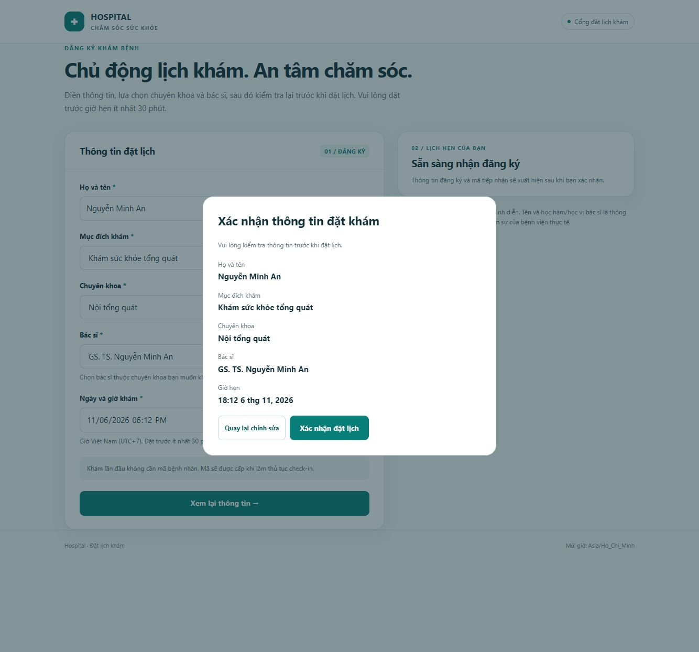
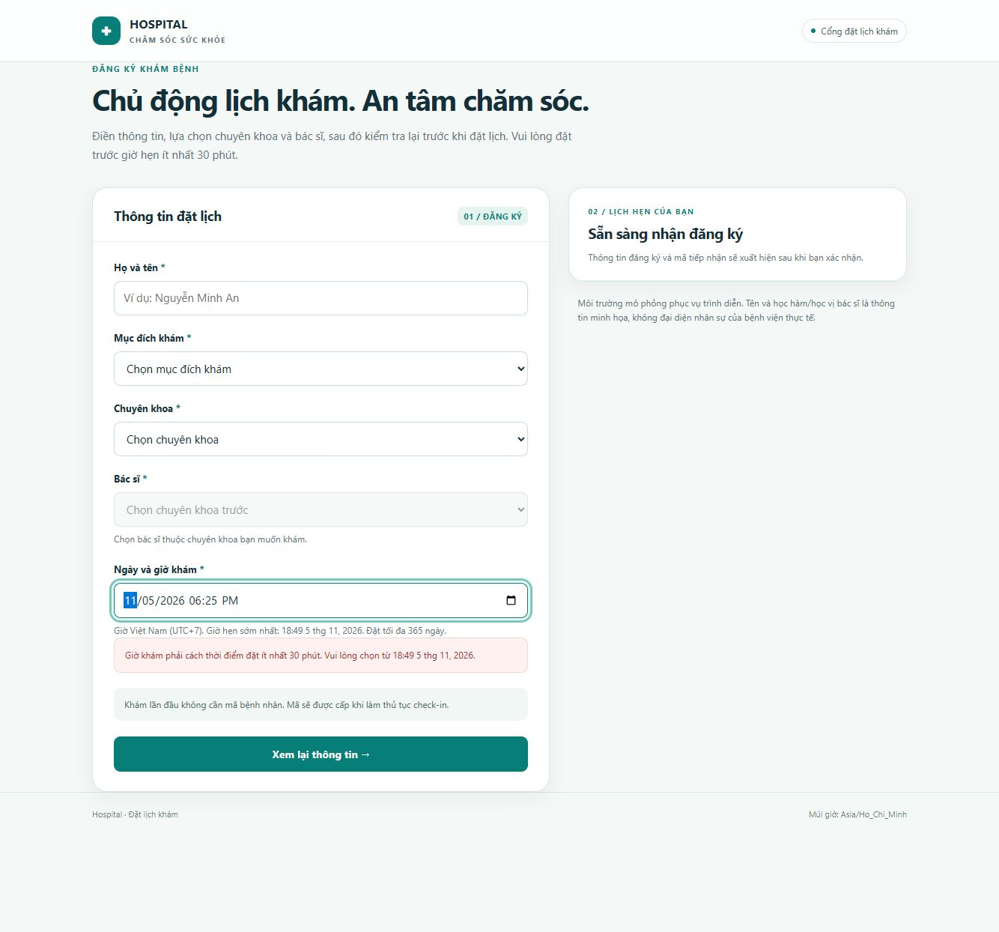

# Kết quả kiểm chứng và phạm vi

Tài liệu tóm tắt các kết quả đã lưu của đồ án, tách nghiệm thu dữ liệu Phase 5 ngày 03/11/2026, cập nhật tiếp nhận ngày 05/11 và tái cấu trúc Compose ngày 06/11. Không coi các phép thử ở các mốc khác nhau là một bộ kiểm thử production duy nhất.

## Dữ liệu và mô hình

- Seed lịch sử: 180 ngày, 06/05–01/11/2026, trung bình 6.000 encounter/ngày.
- 1.080.000 encounter: 1.038.462 ngoại trú và 41.538 nội trú.
- 7.931.367 dòng trên 13 bảng nghiệp vụ nguồn; số dòng không đồng nghĩa số lượt khám.
- ROLAP PostgreSQL; 5 fact, 7 dimension, 2 bridge. [ERD nguồn](diagrams/oltp_erd.mmd), [mô hình DW](diagrams/dw_star_schema.mmd).
- Dữ liệu seed, các giao dịch demo bổ sung và inventory theo thời điểm được phân biệt trong báo cáo. Không sử dụng inventory ngày nghiệm thu như số đếm hiện tại.

## Nghiệm thu Phase 5 ngày 03/11

| Hạng mục | Kết quả ghi nhận |
|---|---|
| Nguồn | 106 constraints được validate, 58 SQL DQ checks, 0 lỗi |
| Unit tests tại thời điểm nghiệm thu | 42 đạt |
| Design checks | 34 đạt |
| SQL fixture assertions lịch sử | 28 đạt |
| KPI lịch sử nguồn so với mart | 9 chỉ số khớp |
| Dashboard | 31 native queries, 16 API assertions đạt |
| Sự kiện | Canonical/dedup, duplicate/late/boundary và replay được kiểm tra |
| Airflow | Hai DAG manual thành công; chưa phải thử tải lịch chạy dài hạn |
| Phục hồi | Bốn database restore sang tên mới, đối soát dữ liệu/schema/sequences/quyền/KPI trong cùng cluster |

### Benchmark

Main paired benchmark gồm 32 biến thể, một client, warm cache, 3 warm-up và 20 mẫu mỗi biến thể. 32/32 result digests trước và sau bằng nhau. Control đảo thứ tự gỡ/khôi phục ba lookup index cho các kết quả sau:

| Truy vấn | Median không index (ms) | Median có index (ms) | Tỷ số trước/sau |
|---|---:|---:|---:|
| Q10 bác sĩ tham gia | 57,411 | 7,085 | 8,10× |
| Q11 chẩn đoán | 75,772 | 22,603 | 3,35× |
| Q12 lọc hai bridge | 157,028 | 11,646 | 13,48× |
| Q15 lịch sử bệnh nhân | 67,716 | 1,802 | 37,57× |

Query đối chứng Q07 chậm hơn khoảng 2,12%; không kết luận toàn hệ thống nhanh hơn hai lần hay quy mọi biến động cho index. Môi trường đo là Ryzen 7 7840HS, Windows 11, Docker khoảng 15,22 GiB RAM. Đây là số đo local của bộ dữ liệu đã khóa, không phải cam kết production.

## Cập nhật tiếp nhận ngày 05/11

Luồng mới có đăng ký lần đầu/tái khám, hồ sơ tạm, check-in, cấp mã bệnh nhân, transactional outbox và tự ghi nhận NO_SHOW sau 30 phút. Hồ sơ bổ sung ghi nhận 35 backend tests, UI checks đạt và 4 appointment đăng ký đã khớp DW ở lần kiểm tra đó. Không cộng máy móc 35 với 42 vì các bộ chạy có thể trùng phạm vi.

Chi tiết nghiệp vụ: [đăng ký và tiếp nhận](BOOKING_RECEPTION.md).

## Tái cấu trúc Compose ngày 06/11

- `docker compose up --build -d` đã build và khởi động project từ thư mục gốc với volume Phase 5 hiện có.
- Mã nguồn được mount trực tiếp từ repository, không cần runtime code snapshot hay thư mục scripts.
- Kiểm thử nguồn trống trong project/volume riêng: sinh và nạp 13 bảng, 1.899 dòng nguồn với 140 encounter, initial ETL và refresh RT thành công.
- Chạy startup lần hai trên bộ thử: bỏ qua seed đã hoàn tất, giữ warehouse hiện có.
- Bộ unit tests sau tái cấu trúc: **61/61 đạt**; Airflow không có lỗi import DAG tại lần kiểm tra.
- Kiểm tra đăng nhập Metabase, bốn dashboard của đồ án, booking health và health Airflow thành công. Init container kết thúc mã 0 là bình thường.

Chạy lại theo hướng dẫn trong [README](../README.md). Các kiểm thử database reception sử dụng database fixture riêng; không dùng chúng để suy ra SLA vận hành.

## Giới hạn

Toàn bộ là dữ liệu mô phỏng trên một máy, một Kafka broker; chưa có CDC tổng quát hoặc HA. Batch vẫn đối soát toàn nguồn và restate facts. Seed không có đầy đủ lịch sử phiên bản bác sĩ, vì vậy các liên kết lịch sử thiếu coverage dùng unknown key. Nghiệm thu Metabase Phase 5 là SQL/API, không phải kiểm tra rendering dashboard; ảnh form thuộc phần kiểm tra giao diện bổ sung. Restore cùng cluster chưa chứng minh phục hồi toàn hạ tầng trên máy mới.

Raw evidence, execution plans, nhật ký các phase, dữ liệu sinh và bản nháp được giữ local để tra cứu, không nằm trong bản repository chọn lọc. Các số trong tài liệu này là kết quả lịch sử, chưa phải kết quả tự động đo lại khi clone dự án.
